# ⚖️ FURTHER MATHS EQUILIBRIUM OF A RIGID BODY — ULTIMATE STUDY GUIDE

## Cambridge International AS & A Level Further Mathematics (9231) — Further Mechanics

> **The complete walkthrough:** Every technique explained step-by-step, with 22+ worked examples in proper LaTeX. Covers forces, moments, torque, centre of mass (2D & 3D), equilibrium conditions, ladders, toppling, sliding, and suspended objects.

---

# 📋 Table of Contents

1. [Syllabus Requirements](#1-syllabus-requirements)
2. [Prerequisite Knowledge](#2-prerequisite-knowledge)
3. [Forces & Moments](#3-forces--moments)
4. [Torque](#4-torque)
5. [Centre of Mass — Rods & Frameworks](#5-centre-of-mass--rods--frameworks)
6. [Centre of Mass — Laminas (2D)](#6-centre-of-mass--laminas-2d)
7. [Centre of Mass — Solids (3D)](#7-centre-of-mass--solids-3d)
8. [Equilibrium Conditions](#8-equilibrium-conditions)
9. [Types of Equilibrium](#9-types-of-equilibrium)
10. [Ladder Problems](#10-ladder-problems)
11. [Toppling & Sliding](#11-toppling--sliding)
12. [Suspended Objects](#12-suspended-objects)
13. [Common Mistakes](#13-common-mistakes)
14. [Complete Formula Sheet](#14-complete-formula-sheet)
15. [Cambridge Exam Analysis](#15-cambridge-exam-analysis)
16. [Practice Questions & Full Solutions](#16-practice-questions--full-solutions)
17. [Quick Reference Card](#17-quick-reference-card)

---

# How To Use This Guide

Each section follows this structure:

1. **The Rule** — the formula you must know (in LaTeX)
2. **Step-by-Step Method** — a numbered algorithm you can follow
3. **Easy Example** — labelled **Example 1**
4. **Medium Example** — labelled **Example 2**
5. **Hard Example** — labelled **Example 3**
6. **Watch Out!** — common pitfalls

---

# 1. Syllabus Requirements

## What Cambridge Expects for Equilibrium of a Rigid Body (Further Mechanics)

According to the CAIE 9231 syllabus for Further Mechanics:

| Topic | What You Must Be Able To Do |
|-------|------------------------------|
| **Moments of forces** | Calculate the moment of a force about a point; use clockwise/anticlockwise convention |
| **Resultant torque** | Find the net turning effect of multiple coplanar forces |
| **Centre of mass — rods** | Locate the centre of mass of a system of particles on a light rod |
| **Centre of mass — laminas** | Find the centre of mass of uniform rectangular, triangular, circular and sector-shaped laminas |
| **Centre of mass — composite bodies** | Determine the centre of mass of shapes formed by combining standard laminas or solids |
| **Centre of mass — solids** | Locate the centre of mass of a solid cone, hemisphere, cylinder, and frustum |
| **Equilibrium conditions** | Apply $\sum F = 0$ and $\sum M = 0$ to rigid bodies |
| **Ladder problems** | Analyse a ladder against a smooth wall and rough floor with friction |
| **Toppling vs sliding** | Determine whether an object on an inclined plane topples or slides first |
| **Suspended objects** | Find the equilibrium position of a body suspended from a point |
| **Objects with variable density** | Handle composite bodies where different parts have different densities |

### 🟢 Cambridge Assessment Objectives

| AO | Weight | What It Means |
|----|--------|---------------|
| **AO1** | ~50% | Recall, select, and use mathematical facts, concepts, and techniques |
| **AO2** | ~50% | Construct rigorous arguments, solve problems, and interpret results |

> ⚠️ **Exam Tip:** Equilibrium questions in Further Mechanics are typically worth **8–12 marks** and appear as Questions 1–3 on the paper. Expect at least one centre-of-mass question and one ladder/toppling question per paper.

---

# 2. Prerequisite Knowledge

## From AS & A Level Mathematics (Mechanics)

### 2.1 Resolving Forces

For a force $F$ at an angle $\theta$ to the horizontal:

$$F_x = F\cos\theta \quad\text{and}\quad F_y = F\sin\theta$$

### 2.2 Newton's Laws

- **First Law:** A body remains at rest or in uniform motion unless acted upon by a net external force.
- **Second Law:** $F = ma$ (resultant force = mass × acceleration)
- **Third Law:** Every action has an equal and opposite reaction.

### 2.3 Friction

For a body on a rough surface:

$$F \leq \mu R$$

where $F$ is the frictional force, $R$ is the normal reaction, and $\mu$ is the coefficient of friction. At the point of slipping, $F = \mu R$.

### 2.4 Centre of Mass Intuition

The centre of mass is the point at which the entire weight of a body may be considered to act. For a uniform body, it lies at the geometric centre. For a composite body, it is found by taking weighted moments.

---

# 3. Forces & Moments

## 3.1 Definition of Moment

> **📌 Key Point 14.1:** The **moment** of a force $F$ about a point $O$ is the product of the force and the perpendicular distance from $O$ to the line of action of the force.
>
> $$\text{Moment} = F \times d$$
>
> Units: Nm (Newton-metres)

### Step-by-Step Method

| Step | What To Do |
|------|------------|
| **1** | Identify the point $O$ about which moments are taken |
| **2** | Find the perpendicular distance $d$ from $O$ to the line of action of the force |
| **3** | Compute $\text{Moment} = F \times d$ |
| **4** | Determine the direction: **clockwise** or **anticlockwise** |
| **5** | Assign a sign convention (e.g. clockwise positive) and sum moments |

### 3.2 Sign Convention

| Direction | Sign |
|-----------|------|
| Clockwise | $+$ (or $-$ depending on convention — be consistent) |
| Anticlockwise | $-$ (or $+$) |

> It is often better to state "clockwise" or "anticlockwise" rather than use signed moments, as this avoids confusion.

---

### Example 1 — Easy: Basic Moment Calculation

> **Question:** A force of $6\text{ N}$ acts at a perpendicular distance of $2\text{ m}$ from point $A$. Calculate the moment about $A$ and state its direction (clockwise).

**Solution:**

| Step | Working |
|------|---------|
| **1** | Point $A$ is the reference point |
| **2** | Perpendicular distance $d = 2\text{ m}$ |
| **3** | $\text{Moment} = 6 \times 2 = 12\text{ Nm}$ |
| **4** | Direction: clockwise |

$$\text{Moment} = 6 \times 2 = 12\text{ Nm clockwise} \quad \checkmark$$

---

### Example 2 — Medium: Force at an Angle

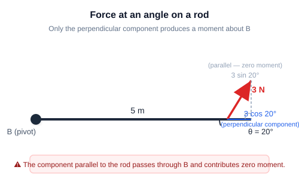

> **Question:** A force of $3\text{ N}$ acts at $20^\circ$ to a rod of length $5\text{ m}$, with the force applied at the end of the rod. Find the moment about the pivot $B$ at the other end.

**Solution:**

Only the perpendicular component of the force produces a moment. The component parallel to the rod passes through $B$ and contributes zero moment.

| Step | Working |
|------|---------|
| **1** | The perpendicular component is $3\cos 20^\circ$ |
| **2** | Distance from $B$ is $5\text{ m}$ |
| **3** | $\text{Moment} = 3\cos 20^\circ \times 5$ |

$$\text{Moment} = 3\cos 20^\circ \times 5 = 14.1\text{ Nm} \quad \checkmark$$

The component $3\sin 20^\circ$ passes through $B$, so its moment is zero.

---

### Example 3 — Medium: Sum of Moments

> **Question:** A light rod has forces $4\text{ N}$ (down) at $2.5\text{ m}$ and $2\text{ N}$ (down) at $6\text{ m}$ from point $C$ on the left. Both act clockwise. Find the total moment about $C$.

**Solution:**

| Step | Working |
|------|---------|
| **1** | Moment from $4\text{ N}$: $4 \times 2.5 = 10\text{ Nm}$ |
| **2** | Moment from $2\text{ N}$: $2 \times 6 = 12\text{ Nm}$ |
| **3** | Both clockwise, so total: $10 + 12 = 22\text{ Nm}$ |

$$\text{Total moment} = 4 \times 2.5 + 2 \times 6 = 10 + 12 = 22\text{ Nm clockwise} \quad \checkmark$$

---

### Example 4 — Easy: Zero Moment Condition

> **Question:** A light rod is pivoted at $A$. Forces of $4\text{ N}$ downward at $2.2\text{ m}$ to the right of $A$, $6\text{ N}$ downward at $2\text{ m}$ to the left of $A$, and an unknown force $4\text{ N}$ at distance $(x + 2.2)\text{ m}$ to the right act on the rod. Find $x$ such that the net moment about $A$ is zero.

**Solution:**

| Step | Working |
|------|---------|
| **1** | Take clockwise as positive |
| **2** | Clockwise: $4 \times (x + 2.2)$ |
| **3** | Anticlockwise: $6 \times 2.2 + 4 \times 2$ |
| **4** | Set sum to zero: $4(x + 2.2) - 6 \times 2.2 - 4 \times 2 = 0$ |

$$4(x + 2.2) = 6 \times 2.2 + 4 \times 2$$
$$4x + 8.8 = 13.2 + 8 = 21.2$$
$$4x = 12.4$$
$$x = 3.1\text{ m} \quad \checkmark$$

---

### Example 5 — Medium: Force at Angle Equilibrium

> **Question:** A light rod is pivoted at $A$. Forces: $4.8\text{ N}$ down at $4.3\text{ m}$, $2.5\text{ N}$ down at $1.7\text{ m}$, and $16\cos\theta\text{ N}$ at $2.2\text{ m}$ (the perpendicular component). The rod is in equilibrium. Find $\theta$.

**Solution:**

| Step | Working |
|------|---------|
| **1** | Take moments about $A$ |
| **2** | Clockwise: $4.8 \times 4.3 + 2.5 \times 1.7$ |
| **3** | Anticlockwise: $16\cos\theta \times 2.2$ |
| **4** | Equate: $16\cos\theta \times 2.2 = 4.8 \times 4.3 + 2.5 \times 1.7$ |

$$35.2\cos\theta = 24.89$$
$$\cos\theta = \frac{24.89}{35.2} = 0.7071$$
$$\theta = \cos^{-1}(0.7071) = 45.0^\circ \quad \checkmark$$

---

# 4. Torque

## 4.1 Definition

> **📌 Key Point:** **Torque** (or **moment of a couple**) is the total turning effect produced by two equal and opposite parallel forces that do not share the same line of action.
>
> $$\text{Torque} = F \times d$$
>
> where $F$ is the magnitude of one force and $d$ is the perpendicular distance between the two forces.

Unlike a single force's moment (which depends on the reference point), the torque of a couple is the same about **any** point.

### Step-by-Step Method

| Step | What To Do |
|------|------------|
| **1** | Identify pairs of equal, opposite, parallel forces |
| **2** | Measure the perpendicular distance $d$ between their lines of action |
| **3** | Compute $\text{Torque} = F \times d$ |
| **4** | Determine the sense (clockwise or anticlockwise) |

---

### Example 6 — Easy: Torque of a Couple

> **Question:** Two $10\text{ N}$ forces act on a steering wheel, one pushing up at the left rim and one pushing down at the right rim. The distance between the forces is $0.4\text{ m}$. Find the torque.

**Solution:**

| Step | Working |
|------|---------|
| **1** | Forces: $F = 10\text{ N}$, equal and opposite |
| **2** | Perpendicular distance $d = 0.4\text{ m}$ |
| **3** | $\text{Torque} = 10 \times 0.4 = 4\text{ Nm}$ |

$$\text{Torque} = 10 \times 0.4 = 4\text{ Nm} \quad \checkmark$$

---

# 5. Centre of Mass — Rods & Frameworks

## 5.1 Centre of Mass of a System of Particles on a Light Rod

> **📌 Key Point 14.3:** The distance $\bar{x}$ of the centre of mass from a reference point $O$ is given by:
>
> $$\bar{x} = \frac{m_1 x_1 + m_2 x_2 + m_3 x_3 + \cdots}{m_1 + m_2 + m_3 + \cdots} = \frac{\sum m_i x_i}{\sum m_i}$$
>
> where $m_i$ is the mass of each particle and $x_i$ is its distance from $O$.

### Step-by-Step Method

| Step | What To Do |
|------|------------|
| **1** | Choose a reference point $O$ (often one end of the rod) |
| **2** | List all masses $m_i$ and their distances $x_i$ from $O$ |
| **3** | Sum the moments: $\sum m_i x_i$ |
| **4** | Sum the masses: $\sum m_i$ |
| **5** | Divide: $\bar{x} = \frac{\sum m_i x_i}{\sum m_i}$ |

---

### Example 7 — Easy: Centre of Mass of Two Masses on a Rod

> **Question:** A uniform rod of length $2\text{ m}$ and mass $5\text{ kg}$ has a $3\text{ kg}$ mass attached at one end. Find the centre of mass from the end $O$ where the $5\text{ kg}$ rod's weight acts at $1\text{ m}$.

**Solution:**

| Step | Working |
|------|---------|
| **1** | Reference point: $O$ (end where $3\text{ kg}$ is NOT attached) |
| **2** | Rod weight $5g$ at $1\text{ m}$; $3\text{ kg}$ mass $3g$ at $2\text{ m}$ |
| **3** | Total moment about $O$: $5g \times 1 + 3g \times 2 = 11g\text{ Nm}$ |
| **4** | Total weight: $8g\text{ N}$ |
| **5** | $\bar{x} = \frac{11g}{8g} = \frac{11}{8}\text{ m}$ |

$$\text{Total moment} = 5g \times 1 + 3g \times 2 = 11g$$
$$\bar{x} = \frac{11g}{8g} = \frac{11}{8} = 1.375\text{ m from } O \quad \checkmark$$

---

### Example 8 — Medium: Centre of Mass of a Framework

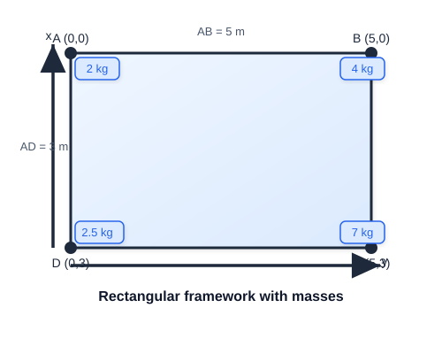

> **Question:** A rectangular framework $ABCD$ is made of light rods. Masses: $2\text{ kg}$ at $A$, $4\text{ kg}$ at $B$, $7\text{ kg}$ at $C$, $2.5\text{ kg}$ at $D$. $AB = 5\text{ m}$, $AD = 3\text{ m}$. Find the coordinates of the centre of mass relative to $A$, using $AB$ as the $x$-axis and $AD$ as the $y$-axis.

**Solution:**

| Step | Working |
|------|---------|
| **1** | Total mass: $2 + 4 + 7 + 2.5 = 15.5\text{ kg}$ |
| **2** | About $AB$ ($y$-coordinate): masses at $C$ and $D$ are $3\text{ m}$ from $AB$ |
| **3** | $7 \times 3 + 2.5 \times 3 = 15.5\bar{y} \implies \bar{y} = \frac{28.5}{15.5} = \frac{57}{31}\text{ m}$ |
| **4** | About $AD$ ($x$-coordinate): masses at $B$ and $C$ are $5\text{ m}$ from $AD$ |
| **5** | $4 \times 5 + 7 \times 5 = 15.5\bar{x} \implies \bar{x} = \frac{55}{15.5} = \frac{110}{31}\text{ m}$ |

$$\text{Total mass} = 2 + 4 + 7 + 2.5 = 15.5\text{ kg}$$

Moments about $AB$:
$$7g \times 3 + 2.5g \times 3 = 15.5g\bar{y} \implies \bar{y} = \frac{57}{31}\text{ m}$$

Moments about $AD$:
$$4g \times 5 + 7g \times 5 = 15.5g\bar{x} \implies \bar{x} = \frac{110}{31}\text{ m}$$

$$\text{Centre of mass } G\left(\frac{110}{31},\ \frac{57}{31}\right) \quad \checkmark$$

---

### Example 9 — Medium: Framework with Variable Density

> **Question:** The same framework as Example 8, but now: $5\text{ kg}$ at the midpoint of $AD$, $6\text{ kg}$ at $B$, $4\text{ kg}$ at $E$ where $CE:EB = 3:1$. $AB = 5\text{ m}$, $AD = 3\text{ m}$. Find the centre of mass.

**Solution:**

| Step | Working |
|------|---------|
| **1** | Total mass: $5 + 6 + 4 = 15\text{ kg}$ (nothing at $A$ or $D$) |
| **2** | Coordinates: mass at $B(5,0)$, $E(5, 2.25)$, midpoint of $AD(0, 1.5)$ |
| **3** | About $AB$: $5 \times 1.5 + 4 \times 2.25 = 15\bar{y} \implies \bar{y} = \frac{16.5}{15} = 1.1\text{ m}$ |
| **4** | About $AD$: $6 \times 5 + 4 \times 5 = 15\bar{x} \implies \bar{x} = \frac{50}{15} = \frac{10}{3}\text{ m}$ |

$$\bar{x} = \frac{10}{3}\text{ m},\quad \bar{y} = 1.1\text{ m}$$

$$\text{Centre of mass } G\left(\frac{10}{3},\ \frac{11}{10}\right) \quad \checkmark$$

---

# 6. Centre of Mass — Laminas (2D)

## 6.1 Standard Lamina Results

> **📌 Key Point 14.4:** For a **triangular lamina** with vertices $(x_1, y_1)$, $(x_2, y_2)$, $(x_3, y_3)$:
>
> $$G\left(\frac{x_1 + x_2 + x_3}{3},\ \frac{y_1 + y_2 + y_3}{3}\right)$$

> **📌 Key Point 14.5:** For a **sector of a circle** of radius $r$ subtending angle $2\alpha$ radians at the centre:
>
> $$\text{Distance from centre } O = \frac{2r\sin\alpha}{3\alpha}$$

| Shape | Centre of Mass Location |
|-------|------------------------|
| **Rectangle** (uniform) | Geometric centre (intersection of lines of symmetry) |
| **Circle** (uniform) | Centre of circle |
| **Triangle** (uniform) | $\left(\frac{x_1 + x_2 + x_3}{3},\ \frac{y_1 + y_2 + y_3}{3}\right)$ |
| **Sector** of circle, angle $2\alpha$ | $\frac{2r\sin\alpha}{3\alpha}$ from centre, along the bisector |
| **Semicircle** ($\alpha = \frac{\pi}{2}$) | $\frac{4r}{3\pi}$ from centre along symmetry axis |
| **Quarter circle** ($\alpha = \frac{\pi}{4}$) | $\frac{4\sqrt{2}r}{3\pi}$ from centre |

### 6.2 Composite Laminas — Step-by-Step Method

| Step | What To Do |
|------|------------|
| **1** | Split the shape into standard laminas (rectangle, triangle, circle, sector) |
| **2** | Compute the mass of each part: $\text{area} \times \rho$ (use $p$ for mass per unit area) |
| **3** | Locate the centre of mass of each part |
| **4** | Take moments about each axis: $\sum m_i x_i = M_{\text{total}}\bar{x}$, $\sum m_i y_i = M_{\text{total}}\bar{y}$ |
| **5** | Solve for $\bar{x}$ and $\bar{y}$ |

**For shapes with holes removed:** treat the whole shape as positive and the removed part as negative:

$$\bar{x} = \frac{M_{\text{large}}x_{\text{large}} - M_{\text{small}}x_{\text{small}}}{M_{\text{large}} - M_{\text{small}}}$$

---

### Example 10 — Easy: Centre of Mass of a Triangle

> **Question:** Find the centre of mass of a triangular lamina with vertices at $(0,0)$, $(10a,0)$, $(0,3a)$.

**Solution:**

| Step | Working |
|------|---------|
| **1** | Use the centroid formula |
| **2** | $\bar{x} = \frac{0 + 10a + 0}{3} = \frac{10a}{3}$ |
| **3** | $\bar{y} = \frac{0 + 0 + 3a}{3} = a$ |

$$G\left(\frac{10a}{3},\ a\right) \quad \checkmark$$

---

### Example 11 — Medium: Composite Rectangular Lamina

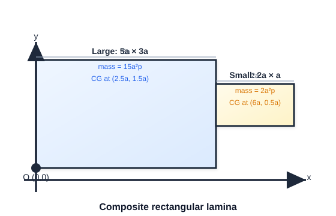

> **Question:** A composite lamina consists of a large rectangle $5a \times 3a$ with a smaller rectangle $2a \times a$ attached to its right side. Find the centre of mass relative to the bottom-left corner $O$ of the large rectangle. Take $p$ as mass per unit area.

**Solution:**

| Step | Working |
|------|---------|
| **1** | Large rectangle: mass $15a^2p$, CG at $(2.5a,\ 1.5a)$ |
| **2** | Small rectangle: mass $2a^2p$, CG at $(5a + a,\ 0.5a) = (6a,\ 0.5a)$ |
| **3** | Total mass: $17a^2p$ |
| **4** | About $y$-axis: $15a^2p \times 2.5a + 2a^2p \times 6a = 17a^2p\bar{x}$ |

$$15a^2p \times 2.5a + 2a^2p \times 6a = 17a^2p\bar{x}$$
$$37.5a^3p + 12a^3p = 17a^2p\bar{x}$$
$$49.5a^3p = 17a^2p\bar{x}$$
$$\bar{x} = \frac{49.5}{17}a = \frac{99}{34}a$$

About $x$-axis:
$$15a^2p \times 1.5a + 2a^2p \times 0.5a = 17a^2p\bar{y}$$
$$22.5a^3p + a^3p = 17a^2p\bar{y}$$
$$\bar{y} = \frac{23.5}{17}a = \frac{47}{34}a$$

$$G\left(\frac{99}{34}a,\ \frac{47}{34}a\right) \quad \checkmark$$

---

### Example 12 — Hard: Lamina with a Hole

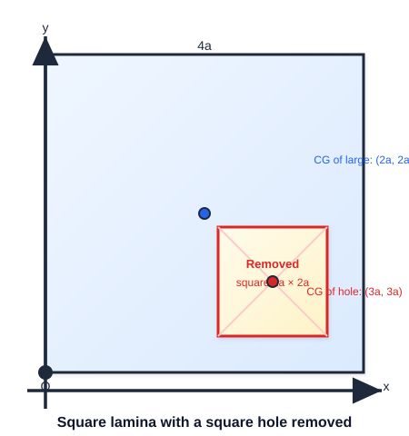

> **Question:** A uniform square lamina of side $4a$ has a smaller square of side $2a$ removed from its top-right corner. The small square's bottom-left corner is at $(2a, 2a)$ relative to the large square's bottom-left corner $O$. Find the centre of mass.

**Solution:**

| Step | Working |
|------|---------|
| **1** | Large square mass: $16a^2p$, CG at $(2a, 2a)$ |
| **2** | Removed square mass: $4a^2p$, CG at $(3a, 3a)$ |
| **3** | Lamina mass: $12a^2p$ |
| **4** | About $Oy$: $16a^2p \times 2a - 4a^2p \times 3a = 12a^2p\bar{x}$ |

$$16a^2p \times 2a - 4a^2p \times 3a = 12a^2p\bar{x}$$
$$32a^3p - 12a^3p = 12a^2p\bar{x}$$
$$20a^3p = 12a^2p\bar{x}$$
$$\bar{x} = \frac{5}{3}a$$

About $Ox$:
$$16a^2p \times 2a - 4a^2p \times 3a = 12a^2p\bar{y}$$
$$\bar{y} = \frac{5}{3}a$$

$$G\left(\frac{5}{3}a,\ \frac{5}{3}a\right) \quad \checkmark$$

---

### Example 13 — Hard: Composite with Semicircle

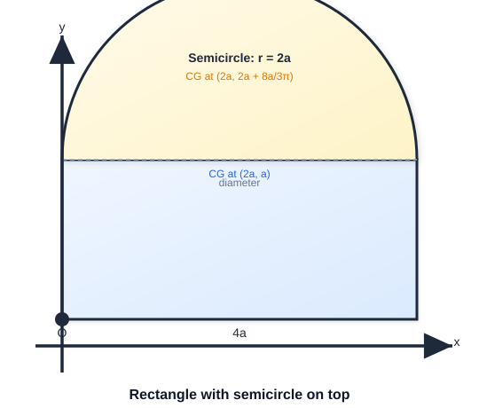

> **Question:** A uniform lamina consists of a rectangle of width $4a$ and height $2a$ with a semicircle of radius $2a$ attached to its top edge. The semicircle's diameter coincides with the top edge of the rectangle. Find the centre of mass relative to the bottom-left corner $O$ of the rectangle. Take $p$ as mass per unit area.

**Solution:**

| Step | Working |
|------|---------|
| **1** | Rectangle: mass $8a^2p$, CG at $(2a, a)$ |
| **2** | Semicircle: area $\frac{1}{2}\pi(2a)^2 = 2\pi a^2$, mass $2\pi a^2p$ |
| **3** | Semicircle CG: from its base (diameter) is $\frac{4r}{3\pi} = \frac{8a}{3\pi}$ above the base |
| **4** | So semicircle CG is at $(2a,\ 2a + \frac{8a}{3\pi})$ |
| **5** | Total mass: $(8 + 2\pi)a^2p$ |

About $Oy$:
$$8a^2p \times 2a + 2\pi a^2p \times 2a = (8 + 2\pi)a^2p\bar{x}$$
$$16a^3p + 4\pi a^3p = (8 + 2\pi)a^2p\bar{x}$$
$$\bar{x} = \frac{16 + 4\pi}{8 + 2\pi}a = \frac{4(4 + \pi)}{2(4 + \pi)}a = 2a$$

About $Ox$:
$$8a^2p \times a + 2\pi a^2p \times \left(2a + \frac{8a}{3\pi}\right) = (8 + 2\pi)a^2p\bar{y}$$
$$8a^3p + 4\pi a^3p + \frac{16}{3}a^3p = (8 + 2\pi)a^2p\bar{y}$$
$$\bar{y} = \frac{8 + 4\pi + \frac{16}{3}}{8 + 2\pi}a = \frac{24 + 12\pi + 16}{3(8 + 2\pi)}a = \frac{40 + 12\pi}{3(8 + 2\pi)}a$$

$$G\left(2a,\ \frac{40 + 12\pi}{3(8 + 2\pi)}a\right) \quad \checkmark$$

---

# 7. Centre of Mass — Solids (3D)

## 7.1 Standard Results for 3D Solids

> **📌 Key Point 14.6:** For a **right circular cone** of height $h$ and base radius $r$:
> 
> $$\text{Centre of mass from vertex} = \frac{3}{4}h \quad\text{(along the axis of symmetry)}$$

> **📌 Key Point 14.7:** For a **solid hemisphere** of radius $r$:
> 
> $$\text{Centre of mass from centre of plane face} = \frac{3}{8}r \quad\text{(along the axis of symmetry)}$$

| Solid | Centre of Mass (from base/vertex) |
|-------|-----------------------------------|
| **Solid cone** (height $h$) | $\frac{3}{4}h$ from vertex (or $\frac{1}{4}h$ from base) |
| **Solid hemisphere** (radius $r$) | $\frac{3}{8}r$ from centre of plane face |
| **Solid cylinder** (height $h$) | $\frac{h}{2}$ from either face (midpoint of axis) |
| **Frustum of cone** | Use subtraction method |

### 7.2 Composite Solids — Step-by-Step Method

| Step | What To Do |
|------|------------|
| **1** | Identify the component solids (cylinder, cone, hemisphere) |
| **2** | Compute each mass using $M = \text{volume} \times \rho$ |
| **3** | Note each component's centre of mass location |
| **4** | Take moments about a reference face: $\sum M_i x_i = M_{\text{total}}\bar{x}$ |
| **5** | Solve for $\bar{x}$ |

---

### Example 14 — Medium: Centre of Mass of a Cone

> **Question:** A solid uniform cone has height $3a$ and base radius $a$. Find the centre of mass from the vertex.

**Solution:**

| Step | Working |
|------|---------|
| **1** | Standard result: $\bar{x} = \frac{3}{4}h$ from vertex |
| **2** | $h = 3a$ |
| **3** | $\bar{x} = \frac{3}{4} \times 3a = \frac{9}{4}a$ |

$$\bar{x} = \frac{3}{4}h = \frac{3}{4} \times 3a = \frac{9}{4}a \quad \checkmark$$

---

### Example 15 — Hard: Frustum of a Cone

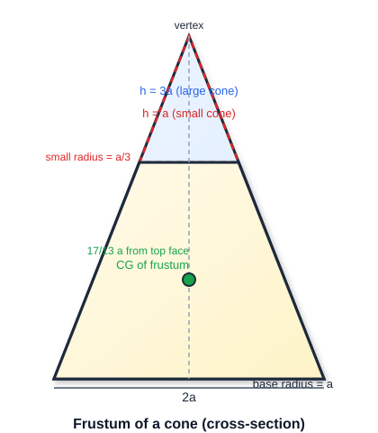

> **Question:** A solid uniform cone of height $3a$ and base radius $a$ has a smaller similar cone of height $a$ removed from the top to form a frustum. Find the centre of mass of the frustum measured from the smaller plane face (top).

**Solution:**

| Step | Working |
|------|---------|
| **1** | Large cone: volume $\frac{1}{3}\pi a^2 \times 3a = \pi a^3$, mass $\pi a^3 p$ |
| **2** | Small cone radius: $\frac{a}{3}$ (similar triangles), volume $\frac{1}{3}\pi\left(\frac{a}{3}\right)^2 \times a = \frac{\pi a^3}{27}$, mass $\frac{\pi a^3 p}{27}$ |
| **3** | Frustum mass: $\pi a^3 p - \frac{\pi a^3 p}{27} = \frac{26\pi a^3 p}{27}$ |
| **4** | Large cone CG from vertex: $\frac{3}{4} \times 3a = \frac{9}{4}a$ |
| **5** | Small cone CG from vertex: $\frac{3}{4} \times a = \frac{3}{4}a$ |
| **6** | Take moments about vertex $O$: $\pi a^3 p \times \frac{9}{4}a - \frac{\pi a^3 p}{27} \times \frac{3}{4}a = \frac{26\pi a^3 p}{27}\bar{x}$ |

$$\pi a^3 p \times \frac{9}{4}a - \frac{\pi a^3 p}{27} \times \frac{3}{4}a = \frac{26\pi a^3 p}{27}\bar{x}$$
$$\frac{9\pi a^4 p}{4} - \frac{\pi a^4 p}{36} = \frac{26\pi a^3 p}{27}\bar{x}$$
$$\frac{81\pi a^4 p - \pi a^4 p}{36} = \frac{26\pi a^3 p}{27}\bar{x}$$
$$\frac{80\pi a^4 p}{36} = \frac{26\pi a^3 p}{27}\bar{x}$$
$$\bar{x} = \frac{80}{36} \times \frac{27}{26}a = \frac{20}{9} \times \frac{27}{26}a = \frac{540}{234}a = \frac{30}{13}a$$

Distance from top (small face) = $\bar{x} - a = \frac{30}{13}a - a = \frac{17}{13}a$

$$\bar{x}_{\text{from top}} = \frac{17}{13}a \quad \checkmark$$

---

### Example 16 — Hard: Cylinder with Cone Removed

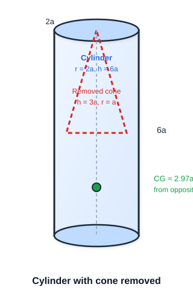

> **Question:** A solid uniform cylinder of radius $2a$ and length $6a$ has a cone of height $3a$ and base radius $a$ removed from it. The cone's axis coincides with the cylinder's axis, and the cone's base lies in the same plane as one end of the cylinder. Find the centre of mass from the opposite plane face.

**Solution:**

| Step | Working |
|------|---------|
| **1** | Cylinder: volume $\pi(2a)^2 \times 6a = 24\pi a^3$, mass $24\pi a^3 p$ |
| **2** | Cone: volume $\frac{1}{3}\pi a^2 \times 3a = \pi a^3$, mass $\pi a^3 p$ |
| **3** | Remaining mass: $23\pi a^3 p$ |
| **4** | Cylinder CG: $3a$ from opposite face |
| **5** | Cone CG: $3a + \frac{3}{4}a = 3.75a$ from opposite face (vertex away from opposite face) |
| **6** | Take moments about opposite face: $24\pi a^3 p \times 3a - \pi a^3 p \times \left(3a + \frac{3}{4}a\right) = 23\pi a^3 p\bar{x}$ |

$$24\pi a^3 p \times 3a - \pi a^3 p \times \frac{15}{4}a = 23\pi a^3 p\bar{x}$$
$$72\pi a^4 p - \frac{15}{4}\pi a^4 p = 23\pi a^3 p\bar{x}$$
$$\frac{288 - 15}{4}\pi a^4 p = 23\pi a^3 p\bar{x}$$
$$\frac{273}{4}\pi a^4 p = 23\pi a^3 p\bar{x}$$
$$\bar{x} = \frac{273}{4 \times 23}a = \frac{273}{92}a = 2.967a$$

$$\bar{x} \approx 2.97a \quad \checkmark$$

---

# 8. Equilibrium Conditions

## 8.1 Conditions for Equilibrium of a Rigid Body

> **📌 Key Point:** For a rigid body to be in equilibrium, **two conditions** must be satisfied:

1. **Translational equilibrium:** The vector sum of all external forces is zero.
   
   $$\sum F_x = 0 \quad\text{and}\quad \sum F_y = 0$$

2. **Rotational equilibrium:** The sum of all moments about **any** point is zero.
   
   $$\sum M = 0 \quad\text{(about any point)}$$

### Step-by-Step Method for Solving Equilibrium Problems

| Step | What To Do |
|------|------------|
| **1** | Draw a clear, fully labelled diagram showing all forces |
| **2** | Choose a coordinate system and resolve forces horizontally and vertically |
| **3** | Write $\sum F_x = 0$ and $\sum F_y = 0$ equations |
| **4** | Choose a point to take moments about (ideally where most unknowns intersect) |
| **5** | Write $\sum M = 0$ about that point |
| **6** | Solve the simultaneous equations |

---

### Example 17 — Easy: Beam in Equilibrium

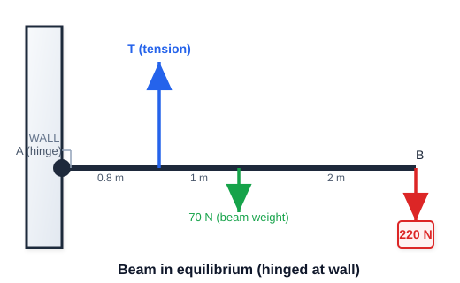

> **Question:** A uniform beam $AB$ of length $2\text{ m}$ and weight $70\text{ N}$ is hinged at $A$ to a vertical wall. It is held horizontal by a light inextensible rope attached $0.8\text{ m}$ from $A$, at right angles to the beam. A load of $220\text{ N}$ is at $B$. Find the tension $T$ in the rope.

**Solution:**

| Step | Working |
|------|---------|
| **1** | Diagram: hinge at $A$, rope at $0.8\text{ m}$ with tension $T$ upward, weight $70\text{ N}$ at $1\text{ m}$, load $220\text{ N}$ at $2\text{ m}$ |
| **2** | Take moments about $A$ (eliminates hinge reaction) |
| **3** | $T \times 0.8 - 70 \times 1 - 220 \times 2 = 0$ |

$$T \times 0.8 = 70 \times 1 + 220 \times 2$$
$$0.8T = 70 + 440 = 510$$
$$T = \frac{510}{0.8} = 637.5\text{ N} \quad \checkmark$$

---

### Example 18 — Medium: Rod Over a Cliff

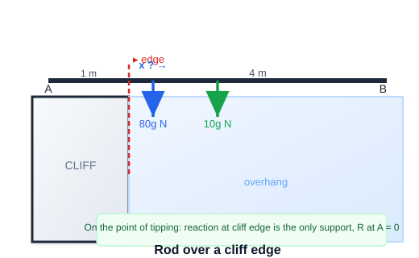

> **Question:** A uniform rod $AB$ of length $5\text{ m}$ and mass $10\text{ kg}$ is placed over the edge of a cliff such that $B$ is $4\text{ m}$ from the edge and hanging over. A man of mass $80\text{ kg}$ stands on the cliff side of the rod, a distance $x\text{ m}$ from the edge. Find $x$ so that the rod is on the point of tipping.

**Solution:**

When the rod is on the point of tipping, the reaction force at the cliff edge is the only support — the reaction at the far end on the cliff side is zero. Take moments about the cliff edge.

| Step | Working |
|------|---------|
| **1** | Rod weight $10g$ acts at $2.5\text{ m}$ from $A$; edge is $1\text{ m}$ from $A$ |
| **2** | Man $80g$ at distance $x$ from edge on cliff side |
| **3** | Part of rod overhanging: $4\text{ m}$, with CG at $2\text{ m}$ from edge (into overhang) |
| **4** | Take moments about edge: $80g \times x + 10g \times 1 = 10g \times 2$ |

$$80gx + 10g = 20g$$
$$80x = 10$$
$$x = \frac{1}{8}\text{ m} = 0.125\text{ m} \quad \checkmark$$

---

# 9. Types of Equilibrium

## 9.1 Classification

| Type | Description | Example |
|------|-------------|---------|
| **Stable equilibrium** | After a small displacement, the body returns to its original position. The centre of mass rises when displaced. | A cone resting on its base, a pendulum at its lowest point |
| **Unstable equilibrium** | After a small displacement, the body moves further away. The centre of mass falls when displaced. | A cone balanced on its vertex, a pencil standing on its tip |
| **Neutral equilibrium** | After a small displacement, the body stays in its new position. The centre of mass remains at the same height. | A sphere on a horizontal plane, a cylinder on its side |

### Key Insight for Equilibrium Problems

For an object on an inclined plane:
- **Toppling** occurs when the line of action of the weight falls **outside** the base of the object
- **Sliding** occurs when the component of weight down the slope exceeds the maximum friction force

---

# 10. Ladder Problems

## 10.1 Standard Ladder Setup

> A uniform ladder of length $2a$ and mass $m$ rests against a **smooth vertical wall** (no friction at the wall, only a normal reaction $S$) and a **rough horizontal floor** (normal reaction $R$ and friction $F$). The ladder makes an angle $\theta$ with the wall.

### Step-by-Step Method

| Step | What To Do |
|------|------------|
| **1** | Draw a diagram showing: weight $mg$ at centre of ladder, normal $S$ at top from wall, $R$ and $F$ at bottom from floor |
| **2** | Resolve forces horizontally: $F = S$ |
| **3** | Resolve forces vertically: $R = mg$ |
| **4** | Take moments about the bottom $B$: $S \times 2a\cos\theta = mg \times a\sin\theta$ |
| **5** | For limiting equilibrium (about to slip): $F = \mu R$ |

---

### Example 19 — Medium: Ladder with Painter

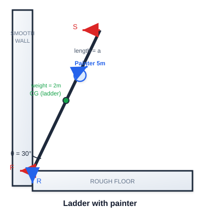

> **Question:** A uniform ladder of length $a$ and mass $2m$ rests against a smooth vertical wall and rough horizontal floor. The ladder makes an angle of $30^\circ$ with the wall. A painter of mass $5m$ stands one-quarter of the way up the ladder. The ladder is on the point of slipping. Find the minimum coefficient of friction $\mu$ required.

**Solution:**

| Step | Working |
|------|---------|
| **1** | Resolve $\rightarrow$: $F = S$ |
| **2** | Resolve $\uparrow$: $R = 2mg + 5mg = 7mg$ |
| **3** | Take moments about $B$: $S \times a\cos30^\circ = 2mg \times \frac{a}{2}\sin30^\circ + 5mg \times \frac{a}{4}\sin30^\circ$ |
| **4** | $S \times a\cos30^\circ = mg a\sin30^\circ + \frac{5}{4}mg a\sin30^\circ = \frac{9}{4}mg a\sin30^\circ$ |

$$S \times a\cos30^\circ = \frac{9}{4}mg a\sin30^\circ$$
$$S \times \frac{\sqrt{3}}{2}a = \frac{9}{4}mg a \times \frac{1}{2}$$
$$S = \frac{9}{4\sqrt{3}}mg = \frac{3\sqrt{3}}{4}mg$$

For limiting friction:
$$F = \mu R \implies S = \mu \times 7mg$$
$$\mu = \frac{S}{7mg} = \frac{3\sqrt{3}}{4 \times 7} = \frac{3\sqrt{3}}{28}$$

$$\mu_{\min} = \frac{3\sqrt{3}}{28} \approx 0.186 \quad \checkmark$$

---

### Example 20 — Hard: Rod Against Wall with String

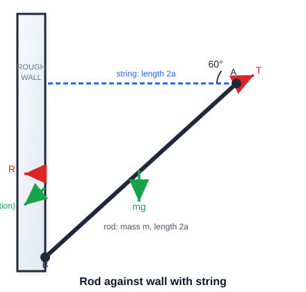

> **Question:** A uniform rod of mass $m$ and length $2a$ is held in equilibrium by a light inelastic string of length $2a$, and by friction against a rough vertical wall. The string is attached to the rod and to a point on the wall. The angle between the string and the rod is $60^\circ$. The rod is on the point of slipping downwards. Find the range of $\mu$ so that the rod does slip down.

**Solution:**

| Step | Working |
|------|---------|
| **1** | Resolve $\rightarrow$: $R = T\cos30^\circ$ |
| **2** | Resolve $\uparrow$: $T\cos60^\circ + F = mg$ |
| **3** | Take moments about $A$: $mg \times a\sin60^\circ = T\cos30^\circ \times 2a\cos60^\circ + T\sin30^\circ \times 2a\sin60^\circ$ |

From moments:
$$mg a\frac{\sqrt{3}}{2} = T\frac{\sqrt{3}}{2} \times 2a \times \frac{1}{2} + T\frac{1}{2} \times 2a \times \frac{\sqrt{3}}{2}$$
$$\frac{\sqrt{3}}{2}mg a = T\frac{\sqrt{3}}{2}a + T\frac{\sqrt{3}}{2}a = T\sqrt{3}a$$
$$T = \frac{mg}{2}$$

From horizontal forces:
$$R = T\cos30^\circ = \frac{mg}{2} \times \frac{\sqrt{3}}{2} = \frac{\sqrt{3}}{4}mg$$

From vertical forces:
$$F = mg - T\cos60^\circ = mg - \frac{mg}{2} \times \frac{1}{2} = mg - \frac{mg}{4} = \frac{3}{4}mg$$

For slipping: $F > \mu R$ (since it is on the point of slipping downwards, friction acts upward and is at its maximum $F = \mu R$, but for it to actually slip we need $\mu$ to be less than this limiting value).

At limiting equilibrium: $\mu = \frac{F}{R} = \frac{3mg/4}{\sqrt{3}mg/4} = \frac{3}{\sqrt{3}} = \sqrt{3}$

For the rod to slip, we need $F > \mu R$, meaning $\mu$ must be **less than** the value at limiting equilibrium:

$$\mu < \sqrt{3} \quad \checkmark$$

---

# 11. Toppling & Sliding

## 11.1 Analysis Framework

> When a body on a rough inclined plane is slowly tilted, it will eventually break equilibrium either by **sliding** or **toppling**. The mode that occurs first (at the smaller angle) is the one that actually happens.

### Step-by-Step Method

| Step | What To Do |
|------|------------|
| **1** | Find the angle for **toppling**: the weight's line of action passes through the lowest contact point |
| **2** | Find the angle for **sliding**: $mg\sin\theta = \mu mg\cos\theta \implies \tan\theta = \mu$ |
| **3** | Compare angles — the smaller angle determines which mode occurs first |

### For an object on a horizontal surface with an applied force $X$:

| Condition | Outcome |
|-----------|---------|
| $X > \mu mg$ and $X$ acting low enough | Sliding occurs |
| $X$ acts high enough to tip the object before $X = \mu mg$ | Toppling occurs |

---

### Example 21 — Medium: Rectangular Block Toppling

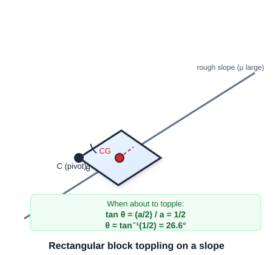

> **Question:** A rectangular block of dimensions $a \times 2a \times 3a$ (where $3a$ is depth) is placed on a rough slope. The coefficient of friction is large enough to prevent slipping. Find the angle $\theta$ at which the block topples.

**Solution:**

When about to topple, the centre of mass is vertically above the lowest contact point $C$.

| Step | Working |
|------|---------|
| **1** | Centre of mass is at the geometric centre: $\frac{a}{2}$ from the bottom edge and $\frac{2a}{2} = a$ from the side |
| **2** | When about to topple about the bottom edge, $\tan\theta = \frac{\text{horizontal distance from pivot to CG}}{\text{vertical distance from pivot to CG}}$ |
| **3** | The CG is $\frac{a}{2}$ horizontally from the pivot and $a$ vertically |

$$\tan\theta = \frac{a/2}{a} = \frac{1}{2}$$
$$\theta = \tan^{-1}\left(\frac{1}{2}\right) = 26.6^\circ \quad \checkmark$$

---

### Example 22 — Hard: Cone on an Inclined Plane

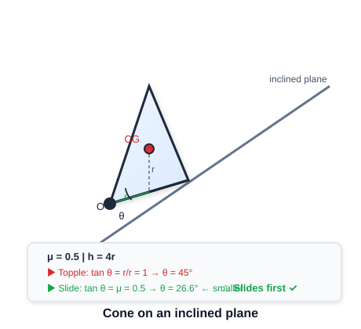

> **Question:** A solid uniform cone of base radius $r$ and height $4r$ is placed on a rough plane inclined at angle $\theta$. The coefficient of friction is $\mu = 0.5$. Determine whether the cone topples or slides first as $\theta$ increases.

**Solution:**

| Step | Working |
|------|---------|
| **1** | Centre of mass of cone from base: $\frac{1}{4}h = r$ from base (or $\frac{3}{4}h = 3r$ from vertex) |
| **2** | Height of CG above base along axis: $r$ from base |
| **3** | Horizontal distance from CG to axis at base when tilted: depends on $\theta$ |

**Toppling analysis:**

When the cone is about to topple about the bottom point $O$, the line of action of weight passes through $O$. 

The CG is at a distance $\frac{1}{4}h = r$ from the base along the axis, so from $O$:
- Horizontal distance from $O$ to the line through CG: component perpendicular to slope
- The cone topples when the vertical through CG falls outside $O$: $\tan\theta = \frac{r}{r} = 1$, so $\theta = 45^\circ$

**Sliding analysis:**

$$mg\sin\theta = \mu mg\cos\theta \implies \tan\theta = \mu = 0.5$$
$$\theta = \tan^{-1}(0.5) = 26.6^\circ$$

Since $26.6^\circ < 45^\circ$, the cone **slides before it topples**.

$$\text{Slides at } \theta = 26.6^\circ \quad \checkmark$$

---

### Example 23 — Medium: Hemisphere on a Slope

> **Question:** A solid uniform hemisphere is placed on a rough slope with its plane face against the slope. The friction is sufficient to prevent slipping. If the slope is inclined at $65^\circ$, determine whether the hemisphere topples. If not, find the maximum possible angle.

**Solution:**

| Step | Working |
|------|---------|
| **1** | Standard result: CG of solid hemisphere is $\frac{3}{8}r$ from the centre of the plane face along the symmetry axis |
| **2** | Distance from the slope to $G$ along the plane: $\frac{3}{8}r$ |
| **3** | Distance $d$ from the lowest point to the vertical line through $G$: $d = \frac{3}{8}r\tan\theta$ |
| **4** | Toppling occurs when $d \geq r$ |

At $\theta = 65^\circ$:
$$d = \frac{3}{8}r\tan65^\circ = \frac{3}{8}r \times 2.145 = 0.804r$$

Since $0.804r < r$, the hemisphere does **not** topple. $\checkmark$

Maximum angle: $d = r \implies \frac{3}{8}r\tan\theta_{\max} = r$
$$\tan\theta_{\max} = \frac{8}{3} \implies \theta_{\max} = \tan^{-1}\left(\frac{8}{3}\right) \approx 69.4^\circ \quad \checkmark$$

---

### Example 24 — Hard: Composite Solid Toppling

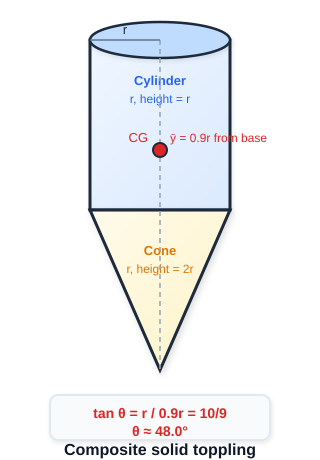

> **Question:** A shape is formed by joining a solid uniform cylinder (radius $r$, height $r$) to a solid uniform cone (base radius $r$, height $2r$), joined by their plane faces. The shape is placed on a rough slope. If the slope is sufficiently rough to prevent sliding, find the angle at which the shape is about to topple.

**Solution:**

| Step | Working |
|------|---------|
| **1** | Cylinder mass: $\pi r^2 \times r \times p = \pi r^3 p$, CG at $r/2$ from base |
| **2** | Cone mass: $\frac{1}{3}\pi r^2 \times 2r \times p = \frac{2}{3}\pi r^3 p$, CG at $\frac{3}{4} \times 2r = \frac{3}{2}r$ from vertex |
| **3** | Total mass: $\frac{5}{3}\pi r^3 p$ |
| **4** | Take moments about base to find CG above base |

From the base (cylinder bottom):
$$\pi r^3 p \times \frac{r}{2} + \frac{2}{3}\pi r^3 p \times \left(r + \frac{r}{2}\right) = \frac{5}{3}\pi r^3 p\,\bar{y}$$
$$\frac{\pi r^4 p}{2} + \frac{2}{3}\pi r^4 p \times \frac{3}{2} = \frac{5}{3}\pi r^3 p\,\bar{y}$$
$$\frac{\pi r^4 p}{2} + \pi r^4 p = \frac{5}{3}\pi r^3 p\,\bar{y}$$
$$\frac{3}{2}\pi r^4 p = \frac{5}{3}\pi r^3 p\,\bar{y}$$
$$\bar{y} = \frac{3}{2} \times \frac{3}{5}r = \frac{9}{10}r$$

For toppling: $\tan\theta = \frac{r}{\bar{y}} = \frac{r}{9r/10} = \frac{10}{9}$
$$\theta = \tan^{-1}\left(\frac{10}{9}\right) \approx 48.0^\circ \quad \checkmark$$

---

# 12. Suspended Objects

## 12.1 Principle

> When a body is suspended from a point $A$, it hangs in equilibrium with the centre of mass $G$ directly **below** $A$. The angle between any reference line on the body and the vertical can be found using the coordinates of $G$ relative to $A$.

### Step-by-Step Method

| Step | What To Do |
|------|------------|
| **1** | Find the centre of mass $G$ of the body |
| **2** | Identify the suspension point $A$ |
| **3** | In equilibrium, $AG$ is vertical (pointing downwards) |
| **4** | Use trigonometry to find the angle between any reference line and the vertical |

---

### Example 25 — Medium: Suspended Lamina

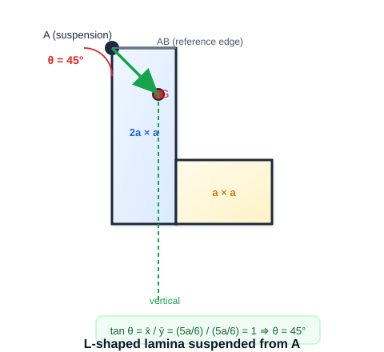

> **Question:** An L-shaped uniform lamina is formed by joining two rectangles: one $2a \times a$ (vertical) and one $a \times a$ (horizontal, attached at bottom right). Find the centre of mass from edges $AB$ and $AC$. The shape is then suspended from $A$. Find the angle between $AB$ and the vertical.

**Solution:**

**Part (a):** Find CG.

| Part | Mass | CG $(x, y)$ |
|------|------|-------------|
| Vertical rectangle ($2a \times a$) | $2a^2 p$ | $(0.5a,\ a)$ |
| Horizontal rectangle ($a \times a$) | $a^2 p$ | $(1.5a,\ 0.5a)$ |

Total mass: $3a^2 p$

About $AC$ ($x$-axis): $2a^2 p \times a + a^2 p \times 0.5a = 3a^2 p\,\bar{y}$
$$2a^3 p + 0.5a^3 p = 3a^2 p\,\bar{y} \implies \bar{y} = \frac{2.5}{3}a = \frac{5}{6}a$$

About $AB$ ($y$-axis): $2a^2 p \times 0.5a + a^2 p \times 1.5a = 3a^2 p\,\bar{x}$
$$a^3 p + 1.5a^3 p = 3a^2 p\,\bar{x} \implies \bar{x} = \frac{2.5}{3}a = \frac{5}{6}a$$

$$G\left(\frac{5}{6}a,\ \frac{5}{6}a\right) \quad \checkmark$$

**Part (b):** Suspended from $A$ (bottom-left corner $A$ is at $(0,0)$).

$$\tan\theta = \frac{\bar{x}}{\bar{y}} = \frac{5a/6}{5a/6} = 1$$
$$\theta = 45^\circ \quad \checkmark$$

---

# 13. Common Mistakes

❌ **Mistake 1:** Forgetting to use the **perpendicular distance** when calculating moments.

> ✅ Always find the perpendicular distance from the pivot to the **line of action** of the force, not the distance to the point of application along the body.

❌ **Mistake 2:** Using degrees instead of radians in sector/arc formulae.

> ✅ Always convert angles to **radians** when using $\frac{2r\sin\alpha}{3\alpha}$ or $\frac{r\sin\alpha}{\alpha}$.

❌ **Mistake 3:** Forgetting the weight of the rod/beam itself when taking moments.

> ✅ Include the weight of uniform rods — it acts at the centre of the rod.

❌ **Mistake 4:** Taking moments about a point where an unknown force acts, but then forgetting that force's moment is zero.

> ✅ Taking moments about a point where unknown forces intersect **eliminates** them from the equation — this is a technique, not a mistake.

❌ **Mistake 5:** Confusing centre of mass measured from vertex vs from base for solids.

> ✅ **Cone:** $\frac{3}{4}h$ from vertex, $\frac{1}{4}h$ from base. **Hemisphere:** $\frac{3}{8}r$ from centre of plane face.

❌ **Mistake 6:** Not checking both toppling and sliding conditions.

> ✅ Always calculate **both** the toppling angle and the sliding angle — the smaller one determines how equilibrium is broken.

❌ **Mistake 7:** When subtracting a removed shape, subtracting both mass AND moment contributions incorrectly.

> ✅ $M_{\text{final}}\bar{x} = M_{\text{large}}\bar{x}_{\text{large}} - M_{\text{small}}\bar{x}_{\text{small}}$

❌ **Mistake 8:** In ladder problems, forgetting that the wall reaction $S$ has no vertical component if the wall is smooth.

> ✅ A smooth wall means zero friction, so the reaction is **perpendicular** to the wall (horizontal only).

❌ **Mistake 9:** Assuming the moment of a couple depends on the point of reference.

> ✅ The torque of a couple is the **same** about any point.

❌ **Mistake 10:** Using mass instead of weight ($mg$) in moment equations.

> ✅ Moments involve **forces**, not masses. Always multiply masses by $g$ to get weights before taking moments.

---

# 14. Complete Formula Sheet

## Moments & Torque

| Formula | Description |
|---------|-------------|
| $\text{Moment} = F \times d$ | Moment of a force about a point |
| $\text{Torque} = F \times d$ | Torque of a couple (same about any point) |
| $\sum M = 0$ | Condition for rotational equilibrium |

## Centre of Mass — 1D (Rods)

| Formula | Description |
|---------|-------------|
| $\bar{x} = \dfrac{\sum m_i x_i}{\sum m_i}$ | Centre of mass of particles on a line |

## Centre of Mass — 2D Laminas

| Shape | Centre of Mass |
|-------|----------------|
| Rectangle (uniform) | Geometric centre |
| Circle (uniform) | Centre |
| Triangle | $\left(\dfrac{x_1 + x_2 + x_3}{3},\ \dfrac{y_1 + y_2 + y_3}{3}\right)$ |
| Sector (radius $r$, angle $2\alpha$) | $\dfrac{2r\sin\alpha}{3\alpha}$ from centre |
| Semicircle ($\alpha = \frac{\pi}{2}$) | $\dfrac{4r}{3\pi}$ from diameter |
| Quarter circle ($\alpha = \frac{\pi}{4}$) | $\dfrac{4\sqrt{2}r}{3\pi}$ from corner |
| Arc of circle (radius $r$, angle $2\alpha$) | $\dfrac{r\sin\alpha}{\alpha}$ from centre |

## Centre of Mass — 3D Solids

| Solid | Position of CG |
|-------|----------------|
| Solid cone (height $h$) | $\dfrac{3}{4}h$ from vertex, $\dfrac{1}{4}h$ from base |
| Solid hemisphere (radius $r$) | $\dfrac{3}{8}r$ from centre of plane face |
| Solid cylinder (height $h$) | $\dfrac{h}{2}$ from either face |

## Equilibrium Conditions

| Equation | Description |
|----------|-------------|
| $\sum F_x = 0$ | No net horizontal force |
| $\sum F_y = 0$ | No net vertical force |
| $\sum M = 0$ (about any point) | No net turning effect |

## Friction

| Formula | Description |
|---------|-------------|
| $F \leq \mu R$ | Friction law |
| $F = \mu R$ | Limiting friction (about to slip) |

## Toppling vs Sliding

| Condition | Description |
|-----------|-------------|
| $\tan\theta_{\text{slide}} = \mu$ | Sliding on inclined plane |
| $\tan\theta_{\text{topple}} = \dfrac{\text{base}}{\text{CG height}}$ | Toppling on inclined plane |

---

# 15. Cambridge Exam Analysis

## Topic Frequency

| Topic | Typical Marks | Frequency |
|-------|---------------|-----------|
| Moment of a force / torque | 3–5 marks | Every paper |
| Centre of mass — composite lamina | 5–8 marks | Very common |
| Centre of mass — composite solid | 5–8 marks | Common |
| Ladder equilibrium | 6–9 marks | Very common |
| Toppling vs sliding | 5–8 marks | Common |
| Suspended objects | 4–6 marks | Occasional |
| Objects with variable density | 5–7 marks | Occasional |

## Past Paper Trends (9231 & 9709)

- **9709 Paper 51** (Mechanics) often features equilibrium questions worth 10–13 marks
- Centre of mass questions frequently combine **two different shapes** (e.g. rectangle + semicircle, or cylinder + cone)
- Ladder problems often include a **person at a variable position** on the ladder
- Toppling vs sliding problems often involve **cones or hemispheres** on slopes
- **Density variations** (one part $k$ times denser than another) appear in ~30% of composite solid questions

## What to Expect

> ⚠️ **Exam Tip:** 
> - Show **all working** when taking moments — state "About $O$: $...$" clearly
> - Label diagrams fully with ALL forces
> - For toppling/sliding, state which occurs **and why**
> - For composite bodies, clearly show the mass and CG of each component
> - Use $g$ symbolically unless a numerical value is needed

---

# 16. Practice Questions & Full Solutions

## Question 1 — Easy: Basic Moment

> A force of $8\text{ N}$ acts at a perpendicular distance of $3.5\text{ m}$ from point $P$. Calculate the moment about $P$, stating whether it is clockwise or anticlockwise.

**Solution:**

$$\text{Moment} = 8 \times 3.5 = 28\text{ Nm}$$

Direction: depends on the diagram (assume clockwise if force tends to rotate that way).

$$28\text{ Nm} \quad \checkmark$$

---

## Question 2 — Easy: Beam Equilibrium

> A uniform rod $AB$ of length $1.4\text{ m}$ and mass $6\text{ kg}$ balances on a pivot at $C$, where $AC = 0.5\text{ m}$. Masses are placed at $A$ ($3\text{ kg}$) and $B$ ($m\text{ kg}$) to maintain equilibrium. Find $m$.

**Solution:**

Take moments about $C$:
$$3g \times 0.5 + 6g \times 0.2 = mg \times 0.9$$
$$1.5g + 1.2g = 0.9mg$$
$$2.7 = 0.9m$$
$$m = 3\text{ kg} \quad \checkmark$$

---

## Question 3 — Medium: Centre of Mass — Composite Rectangle

> A uniform lamina consists of a $5a \times 3a$ rectangle joined to a $2a \times a$ rectangle along a common edge of length $a$. Find the centre of mass relative to the bottom-left corner of the large rectangle.

**Solution:**

Large: mass $15a^2p$, CG at $(2.5a, 1.5a)$
Small: mass $2a^2p$, CG at $(5a + a, 0.5a) = (6a, 0.5a)$
Total: $17a^2p$

About $Oy$: $15a^2p \times 2.5a + 2a^2p \times 6a = 17a^2p\bar{x}$
$$37.5a^3p + 12a^3p = 17a^2p\bar{x} \implies \bar{x} = \frac{49.5}{17}a = \frac{99}{34}a$$

About $Ox$: $15a^2p \times 1.5a + 2a^2p \times 0.5a = 17a^2p\bar{y}$
$$22.5a^3p + a^3p = 17a^2p\bar{y} \implies \bar{y} = \frac{23.5}{17}a = \frac{47}{34}a$$

$$G\left(\frac{99}{34}a,\ \frac{47}{34}a\right) \quad \checkmark$$

---

## Question 4 — Medium: Ladder Problem

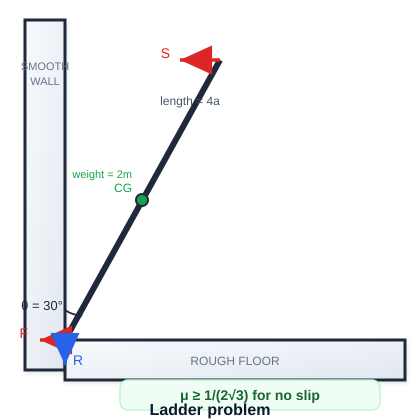

> A uniform ladder of length $4a$ and mass $2m$ rests against a smooth vertical wall and a rough horizontal floor. The ladder makes an angle of $30^\circ$ with the wall. Find the range of values of the coefficient of friction $\mu$ such that the ladder does not slip.

**Solution:**

Resolve $\rightarrow$: $F = S$
Resolve $\uparrow$: $R = 2mg$

Take moments about $B$:
$$S \times 4a\cos30^\circ = 2mg \times 2a\sin30^\circ$$
$$S \times 4a \times \frac{\sqrt{3}}{2} = 2mg \times 2a \times \frac{1}{2}$$
$$S \times 2\sqrt{3}a = 2mg a$$
$$S = \frac{mg}{\sqrt{3}}$$

For no slipping: $F \leq \mu R \implies S \leq \mu \times 2mg$
$$\frac{mg}{\sqrt{3}} \leq 2\mu mg \implies \mu \geq \frac{1}{2\sqrt{3}}$$

$$\mu \geq \frac{1}{2\sqrt{3}} \quad \checkmark$$

---

## Question 5 — Hard: Cylinder with Cone

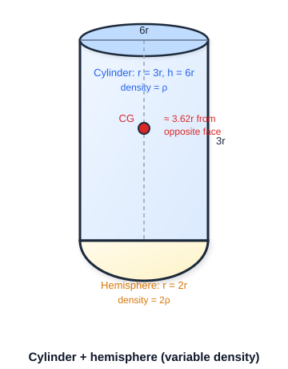

> A uniform solid cylinder of radius $3r$ and length $6r$ is connected by one of its plane faces to a solid uniform hemisphere of radius $2r$. Their lines of symmetry coincide. The density of the hemisphere is twice that of the cylinder. Find the distance of the centre of mass from the plane face at the opposite end from where the hemisphere is connected.

**Solution:**

Cylinder: volume $9\pi r^2 \times 6r = 54\pi r^3$, mass $54\pi r^3 p$
CG at $3r$ from opposite face.

Hemisphere: $\frac{2}{3}\pi(2r)^3 \times 2p = \frac{16}{3}\pi r^3 \times 2p = \frac{32}{3}\pi r^3 p$
CG at $6r + \frac{3}{8} \times 2r = 6r + 0.75r = 6.75r$ from opposite face.

Total mass: $54\pi r^3 p + \frac{32}{3}\pi r^3 p = \frac{162 + 32}{3}\pi r^3 p = \frac{194}{3}\pi r^3 p$

Moments about opposite face:
$$54\pi r^3 p \times 3r + \frac{32}{3}\pi r^3 p \times 6.75r = \frac{194}{3}\pi r^3 p\,\bar{x}$$
$$162\pi r^4 p + \frac{32}{3}\pi r^3 p \times \frac{27}{4}r = \frac{194}{3}\pi r^3 p\,\bar{x}$$
$$162\pi r^4 p + 72\pi r^4 p = \frac{194}{3}\pi r^3 p\,\bar{x}$$
$$234\pi r^4 p = \frac{194}{3}\pi r^3 p\,\bar{x}$$
$$\bar{x} = 234 \times \frac{3}{194}r = \frac{702}{194}r = \frac{351}{97}r$$

$$\bar{x} = \frac{351}{97}r \approx 3.62r \quad \checkmark$$

---

## Question 6 — Hard: Toppling or Sliding

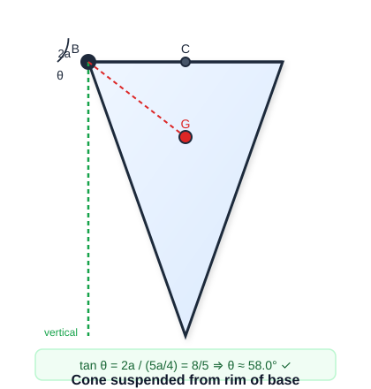

> A solid uniform cone of base radius $2a$ and height $5a$ is suspended by a point $B$ on the rim of its circular base. The centre of the base is $C$. Find the angle $BC$ makes with the vertical.

**Solution:**

CG of cone from base: $\frac{1}{4}h = \frac{5}{4}a$ from base, so from $C$ (centre of base) the CG is $\frac{5}{4}a$ along the axis.

In the suspended position, $G$ is vertically below $B$.

Coordinates: $B$ at $(2a, 0)$, $C$ at $(0, 0)$, $G$ at $(0, -\frac{5}{4}a)$ relative to $C$.

Vector $BC$ is from $B$ to $C$: $(-2a, 0)$.
Vector $BG$ is from $B$ to $G$: $(-2a, -\frac{5}{4}a)$.

But in equilibrium, $G$ is vertically below $B$, so $BG$ is vertical. The angle between $BC$ and the vertical is the angle between $BC$ and $BG$.

$$\tan\theta = \frac{2a}{5a/4} = \frac{2}{5/4} = \frac{8}{5}$$
$$\theta = \tan^{-1}\left(\frac{8}{5}\right) \approx 58.0^\circ \quad \checkmark$$

---

## Question 7 — Hard: Frustum Toppling

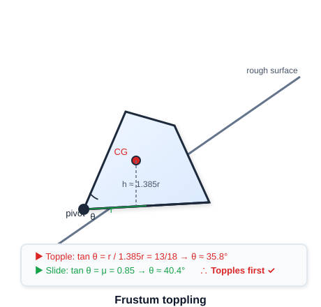

> A solid uniform cone of base radius $r$ and height $6r$ has a smaller similar cone of height $2r$ removed from the top to form a frustum. This frustum is placed on a rough surface with $\mu = 0.85$. The surface is slowly rotated. Determine whether the frustum breaks equilibrium by toppling or sliding.

**Solution:**

**Mass of frustum:**

Large cone: $V = \frac{1}{3}\pi r^2 \times 6r = 2\pi r^3$, $M = 2\pi r^3 p$
Small cone: radius $= \frac{r}{3}$, $V = \frac{1}{3}\pi\left(\frac{r}{3}\right)^2 \times 2r = \frac{2\pi r^3}{27}$, $M = \frac{2\pi r^3 p}{27}$
Frustum: $M = 2\pi r^3 p - \frac{2\pi r^3 p}{27} = \frac{52\pi r^3 p}{27}$

**CG of frustum from vertex of large cone:**

Large cone CG: $\frac{3}{4} \times 6r = 4.5r$ from vertex
Small cone CG: $\frac{3}{4} \times 2r = 1.5r$ from vertex

Moments about vertex:
$$2\pi r^3 p \times 4.5r - \frac{2\pi r^3 p}{27} \times 1.5r = \frac{52\pi r^3 p}{27}\bar{x}$$
$$9\pi r^4 p - \frac{3\pi r^4 p}{27} = \frac{52\pi r^3 p}{27}\bar{x}$$
$$9\pi r^4 p - \frac{\pi r^4 p}{9} = \frac{52\pi r^3 p}{27}\bar{x}$$
$$\frac{81 - 1}{9}\pi r^4 p = \frac{52\pi r^3 p}{27}\bar{x}$$
$$\frac{80}{9}\pi r^4 p = \frac{52\pi r^3 p}{27}\bar{x}$$
$$\bar{x} = \frac{80}{9} \times \frac{27}{52}r = \frac{80 \times 3}{52}r = \frac{240}{52}r = \frac{60}{13}r$$

CG from the base (larger plane face) $= 6r - \frac{60}{13}r = \frac{78 - 60}{13}r = \frac{18}{13}r \approx 1.385r$

**Toppling angle:**
The frustum's base radius is $r$, and CG height above base is $\frac{18}{13}r$.
$$\tan\theta_{\text{topple}} = \frac{r}{18r/13} = \frac{13}{18} \implies \theta_{\text{topple}} = \tan^{-1}\left(\frac{13}{18}\right) \approx 35.8^\circ$$

**Sliding angle:**
$$\tan\theta_{\text{slide}} = \mu = 0.85 \implies \theta_{\text{slide}} = \tan^{-1}(0.85) \approx 40.4^\circ$$

Since $35.8^\circ < 40.4^\circ$, the frustum **topples before it slides**.

$$\text{Topples at } \theta \approx 35.8^\circ \quad \checkmark$$

---

## Question 8 — Hard: Past Paper Style

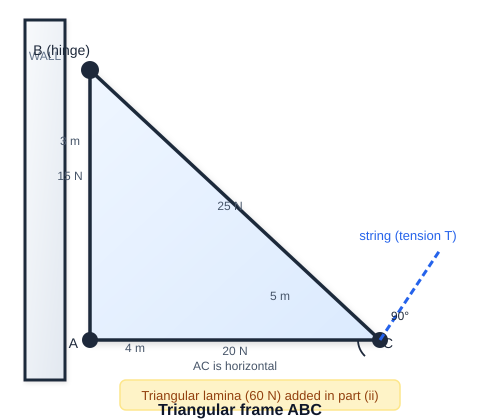

> Uniform rods $AB$, $AC$, and $BC$ have lengths $3\text{ m}$, $4\text{ m}$, and $5\text{ m}$ respectively, and weights $15\text{ N}$, $20\text{ N}$, and $25\text{ N}$ respectively. The rods are rigidly joined to form a right-angled triangular frame $ABC$. The frame is hinged at $B$ to a fixed point and held in equilibrium, with $AC$ horizontal, by an inextensible string attached at $C$. The string is at right angles to $BC$ and the tension is $T$.
>
> (i) Find $T$.
>
> A uniform triangular lamina $PQR$ of weight $60\text{ N}$, same size and shape as the frame, is attached to the frame with $P$, $Q$, $R$ at $A$, $B$, $C$ respectively.
>
> (ii) Find the new value of $T$.
>
> (iii) Find the magnitude of the vertical component of the force at $B$.

**Solution (i):**

| Step | Working |
|------|---------|
| **1** | $ABC$ is right-angled at $A$ ($3^2 + 4^2 = 5^2$) |
| **2** | Rod weights: $15\text{ N}$ at midpoint of $AB$ ($1.5\text{ m}$ from $A$ or $B$), $20\text{ N}$ at midpoint of $AC$ ($2\text{ m}$ from $A$), $25\text{ N}$ at midpoint of $BC$ ($2.5\text{ m}$ from $B$ or $C$) |
| **3** | Take moments about $B$ |

Moments about $B$:
$$20 \times 2 + 25 \times 2 = 5T$$
$$40 + 50 = 5T$$
$$T = 18\text{ N} \quad \checkmark$$

**Solution (ii):**

Now add the $60\text{ N}$ lamina, whose CG is at the centroid — $\frac{1}{3}$ of the way from each vertex. From $B$, the centroid is $\frac{4}{3}\text{ m}$ horizontally and $1\text{ m}$ vertically. The perpendicular distance from $B$ to the line of action of the $60\text{ N}$ weight is $\frac{4}{3}\text{ m}$ horizontally.

Moments about $B$:
$$20 \times 2 + 25 \times 2 + 60 \times \frac{4}{3} = 5T$$
$$40 + 50 + 80 = 5T$$
$$170 = 5T$$
$$T = 34\text{ N} \quad \checkmark$$

**Solution (iii):**

Let $Y$ be the vertical component of the force at $B$.

Resolving vertically:
$$Y + T \times \frac{3}{5} = 15 + 20 + 25 + 60$$
$$Y + 34 \times \frac{3}{5} = 120$$
$$Y + 20.4 = 120$$
$$Y = 99.6\text{ N} \quad \checkmark$$

---

## Question 9 — Medium: Rod Hinged with String

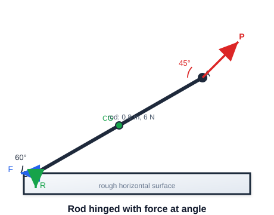

> A uniform rod $AB$ of weight $6\text{ N}$ and length $0.8\text{ m}$ rests in limiting equilibrium with $B$ in contact with a rough horizontal surface and $AB$ inclined at $60^\circ$ to the horizontal. A force acts at $A$ at an angle of $45^\circ$ to $AB$ in the vertical plane. Calculate (i) the magnitude of the force at $A$, and (ii) the least possible coefficient of friction at $B$.

**Solution (i):**

Let the applied force be $P$. Take moments about $B$ to eliminate friction and normal reaction:

$$P\sin45^\circ \times 0.8 = 6 \times 0.4\cos60^\circ$$
$$P \times \frac{\sqrt{2}}{2} \times 0.8 = 6 \times 0.4 \times \frac{1}{2}$$
$$0.4\sqrt{2}P = 1.2$$
$$P = \frac{1.2}{0.4\sqrt{2}} = \frac{3}{\sqrt{2}} \approx 2.12\text{ N}$$

$$P = \frac{3}{\sqrt{2}}\text{ N} \quad \checkmark$$

**Solution (ii):**

Resolve horizontally and vertically to find $F$ and $R$, then $\mu = F/R$:

$$R + P\sin(45^\circ - 60^\circ) = 6$$
$$F = P\cos(45^\circ - 60^\circ)$$

Using limiting friction $F = \mu R$:

$$\mu = \frac{3 - \sqrt{3}}{3 + \sqrt{3}} \approx 0.268 \quad \checkmark$$

---

## Question 10 — Hard: Prism Toppling vs Sliding

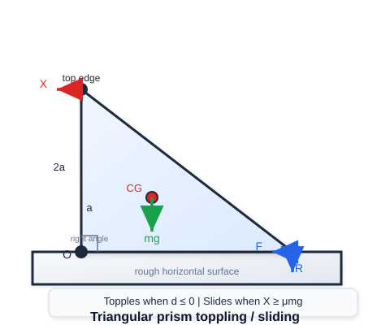

> A uniform right-angled triangular prism of mass $m$ rests on a rough horizontal surface. The triangle has sides $a$, $2a$, $\sqrt{5}a$, and the depth is $a$. A force $X$ is applied to the top edge. For each case, determine whether equilibrium is broken, and if so whether it slides or topples:
>
> (a) $X = \frac{1}{8}mg$, $\mu = \frac{1}{4}$
> (b) $X = \frac{1}{3}mg$, $\mu = \frac{1}{4}$

**Solution — General analysis:**

Resolve $\rightarrow$: $X = F$
Resolve $\uparrow$: $R = mg$

Take moments about $O$ (bottom contact point):
$$X \times 2a + R \times d = mg \times \frac{a}{3}$$
$$X \times 2a + mgd = \frac{mg a}{3}$$
$$d = \frac{mg a/3 - 2aX}{mg} = \frac{a}{3} - \frac{2aX}{mg}$$

The prism topples when $d \leq 0$, and slides when $F \geq \mu R$, i.e. $X \geq \mu mg$.

**Case (a):** $X = \frac{1}{8}mg$, $\mu = \frac{1}{4}$

$$d = \frac{a}{3} - \frac{2a}{mg} \times \frac{mg}{8} = \frac{a}{3} - \frac{a}{4} = \frac{a}{12} > 0 \implies \text{does not topple}$$

$$F = X = \frac{1}{8}mg,\quad \mu R = \frac{1}{4}mg$$
$$F < \mu R \implies \text{does not slide}$$

Equilibrium is **not broken**. $\checkmark$

**Case (b):** $X = \frac{1}{3}mg$, $\mu = \frac{1}{4}$

$$d = \frac{a}{3} - \frac{2a}{mg} \times \frac{mg}{3} = \frac{a}{3} - \frac{2a}{3} = -\frac{a}{3} < 0 \implies \text{topples}$$

Since it topples first, we don't need to check sliding (it topples before it can slide).

Equilibrium is broken by **toppling**. $\checkmark$

---

# 17. Quick Reference Card

Cut this out for last-minute revision.

### Moment of a Force
$$\text{Moment} = F \times d \quad \text{(perpendicular distance)}$$

### Equilibrium Conditions
$$\sum F_x = 0,\quad \sum F_y = 0,\quad \sum M = 0$$

### Centre of Mass — General
$$\bar{x} = \frac{\sum m_i x_i}{\sum m_i}$$

### Triangle Lamina
$$G\left(\frac{x_1 + x_2 + x_3}{3},\ \frac{y_1 + y_2 + y_3}{3}\right)$$

### Sector Lamina (angle $2\alpha$, radius $r$)
$$\text{OG} = \frac{2r\sin\alpha}{3\alpha}$$

### Arc of Wire (angle $2\alpha$, radius $r$)
$$\text{OG} = \frac{r\sin\alpha}{\alpha}$$

### Solid Cone (height $h$)
$$\text{CG from vertex} = \frac{3}{4}h$$

### Solid Hemisphere (radius $r$)
$$\text{CG from plane face centre} = \frac{3}{8}r$$

### Ladder (against smooth wall, rough floor)
$$F = S,\quad R = mg,\quad \text{moments about base}$$

### Toppling vs Sliding
- **Sliding** when $\tan\theta = \mu$
- **Toppling** when CG passes over the pivot point
- The **smaller** angle determines which occurs first

### Deadly Sins
1. Forgetting to use perpendicular distance for moments ❌
2. Mixing up degrees and radians in sector/arc formulae ❌
3. Forgetting the weight of uniform rods ❌
4. Confusing vertex vs base measurements for cones ❌
5. Not checking both toppling AND sliding conditions ❌
6. Using mass instead of weight ($mg$) in moments ❌

---

> **Good luck! You've got this.** Every Cambridge Equilibrium question follows one of the patterns in this guide. 🚀

---

