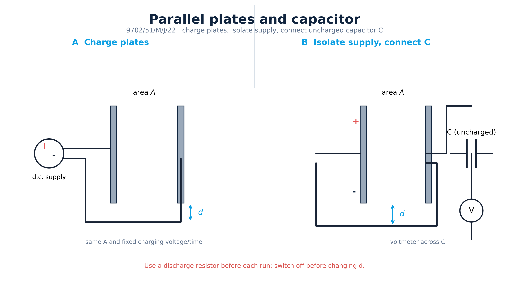
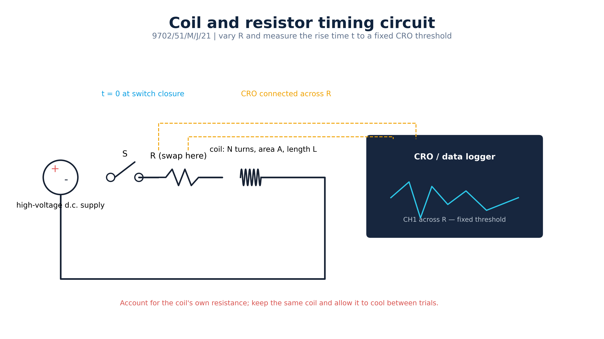
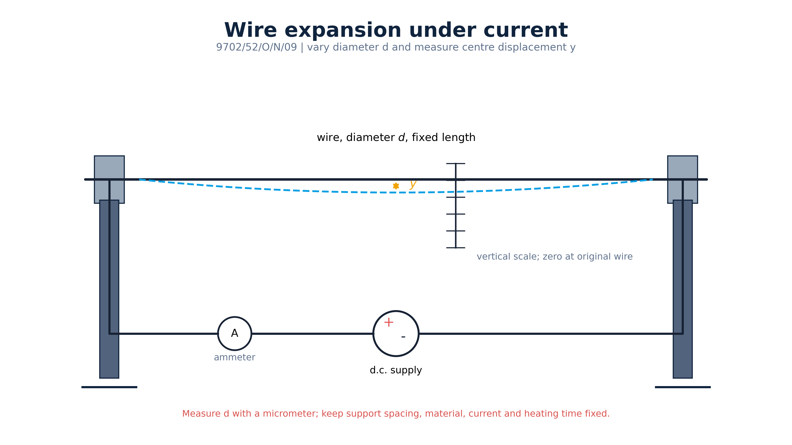
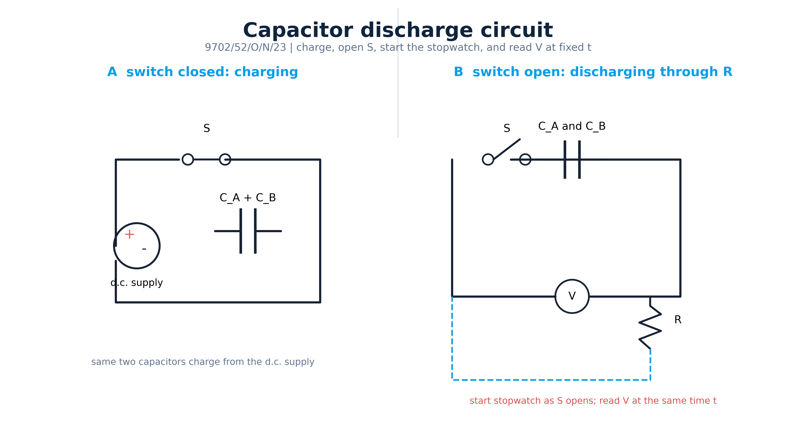
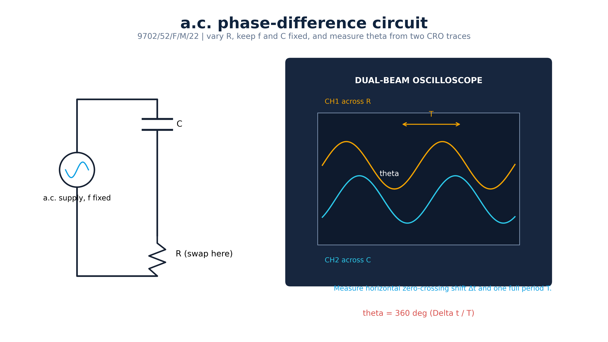

# CAIE Physics 9702 — Paper 5 ELECTRICITY FOCUS

> **Full 15/15 model answers — electricity only.** Written exactly as the mark scheme awards marks.
> Source: `paper 5 question 1 physics.md` (Q1) + `paper 5 question 2 physics.md` (Q2) + `Paper-5-WS_26x27.pdf`
> **Sir said: "both Q1 and Q2 are from electricity — anything electricity related" — these 5 are the ones to revise.**

| # | Paper | Page | Code | Question | Equation | Graph |
|---|-------|------|------|----------|----------|-------|
| 1 | **Q1** | 31 | 9702/51/M/J/22 | **Parallel plates + capacitor** | $V = \frac{W}{1+Cd/(KA)}$ | $1/V$ vs $d$ |
| 2 | **Q1** | 34 | 9702/51/M/J/21 | **Coil + resistor timing** | $t = \frac{KN^{2}A}{LR}$ | $t$ vs $1/R$ |
| 3 | **Q1** | 37 | 9702/52/O/N/09 | **Wire heated by current** | $y = p d^{\,q}$ | $\lg y$ vs $\lg d$ |
| 4 | **Q2** | 73 | 9702/52/O/N/23 | **Capacitor discharge** | $V = I_{0}R\,e^{-t/CR}$ | $\ln V$ vs $1/C$ |
| 5 | **Q2** | 77 | 9702/52/F/M/22 | **AC phase (capacitor + resistor)** | $\tan\theta = \frac{1}{2\pi fCR}$ | $\tan\theta$ vs $1/R$ |

> **Do 1, 4, 5 first if short on time** — $C,R,V,I,f$ appear every year.

---

# PART A — Q1 PLANNING — Full 15/15 Model Answers

---

## Q1-1 — Parallel Plates + Capacitor (9702/51/M/J/22) — $V = \frac{W}{1+Cd/(KA)}$

### Model Answer (copy this structure in exam — 15 marks)

**Variables:**
- Independent variable: separation $d$ of the parallel plates (varied using spacers/micrometer screw).
- Dependent variable: potential difference $V$ across the uncharged capacitor after connection.
- Quantities to be kept constant: capacitance $C$ of the uncharged capacitor, plate area $A$, constant $W$ (supply/charge conditions), and $K$. Also keep temperature constant.

**Apparatus (list):** Two parallel metal plates (area $A$, separation $d$ variable), d.c. power supply, uncharged capacitor $C$, digital voltmeter, micrometer screw gauge (0.01 mm) and vernier calipers for $A$, spacers, shrouded leads, G-clamp, bench.

**Diagram:** As shown above — plates connected to supply for charging, then switched to capacitor $C$ with voltmeter in parallel across $C$. Plates mounted vertically on G-clamped retort stand. Label $d$ between plates, area $A$, capacitor $C$, voltmeter $V$, supply. Use correct circuit symbols.

**Procedure (step-by-step):**
1. Measure plate dimensions (length and width) with vernier calipers at several positions and orientations, calculate mean and hence area $A = l \times w$. Record.
2. Set initial small separation $d$ using spacers. Measure $d$ with micrometer screw gauge at at least 3 different positions between plates, calculate mean $d$ and half-range as uncertainty.
3. Connect plates to d.c. supply and charge for a fixed time (e.g. 30 s) at a fixed supply voltage (record with voltmeter — keep constant for all runs).
4. Quickly switch plates to uncharged capacitor $C$ (ensure capacitor is fully discharged before each run by shorting through a resistor). Measure p.d. $V$ across $C$ with digital voltmeter. Repeat the $V$ reading 3 times for this $d$ (recharging each time) and calculate mean $V$.
5. Increase $d$ (remove/add spacers or adjust micrometer screw) and repeat steps 2–4. Obtain at least 6 values of $d$ spanning the widest available range while keeping $d \ll \sqrt{A}$ (small-distance condition stated in question).
6. For each $d$, calculate $1/V$ and tabulate $d$, $V$, $1/V$ with uncertainties. Show one sample calculation.

**Control of variables:**
- $C$: use the same uncharged capacitor for every reading — do not change capacitor.
- $A$: use the same plates throughout — do not change plates; check $A$ is unchanged.
- Initial charge $W$: keep charging voltage and charging time identical for every run (monitor supply with voltmeter before each charge).
- Temperature and humidity kept constant by conducting in same room.

**Analysis:**
Rearrange: $V = \frac{W}{1+Cd/(KA)} \Rightarrow \frac{1}{V} = \frac{C}{WKA}\,d + \frac{1}{W}$
So plot $y = 1/V$ on y-axis against $x = d$ on x-axis.
$$ \frac{1}{V} = \left(\frac{C}{WKA}\right) d + \frac{1}{W} $$
- Gradient $m = \frac{C}{WKA}$
- y-intercept $c = \frac{1}{W}$
If the relationship is valid the graph will be a straight line. Gradient and intercept are found from the best-fit line (with worst acceptable line for uncertainties).
Then: $W = \frac{1}{c}$ and $K = \frac{C}{mWA}$ (rearrange gradient expression). $C$ and $A$ are known from measurements.

**Additional detail (D-mark):** Measure $d$ at several points between plates and average to account for non-parallelism / non-uniformity. Use large range of $d$ to reduce percentage uncertainty and improve gradient accuracy.

**Safety:**
- Electric shock: switch off supply before changing $d$ or touching plates; use shrouded leads; discharge capacitor through a resistor before handling — because plates are charged to high voltage and capacitor stores charge.
- Falling plates: G-clamp the plate stands to the bench and use a sand tray below — because plates are heavy and may topple.
- (Link hazard → precaution explicitly — generic "wear goggles" alone scores 0.)

**How to find $K,W$:** From graph, $W = 1/(\text{intercept})$, $K = C/( \text{gradient} \times W \times A)$. State both with units.

---

## Q1-2 — Coil + Resistor Timing (9702/51/M/J/21) — $t = \frac{KN^{2}A}{LR}$

### Model Answer (copy this structure in exam — 15 marks)

**Variables:**
- Independent variable: resistance $R$ — $R$ is the independent variable and $t$ is the dependent variable or vary $R$ and measure $t$ (P1 — MS).
- Dependent variable: time $t$ for current to reach maximum value after switch closed (of a few milliseconds).
- Quantities to be kept constant: number of turns on the coil $N$ — keep the number of turns on the coil/$N$ constant (P2). Also keep $A$ and $L$ constant (D3), and supply voltage constant.

**Apparatus (list):** Coil (known $N$, $L$, $A$), set of unmarked resistors (different $R$), d.c. power supply (high voltage), switch, digital ohmmeter / ammeter + voltmeter, (storage) oscilloscope or current/voltage sensor connected to datalogger/computer (to determine $t$ of a few milliseconds), micrometer screw gauge / vernier calipers (to determine diameter and hence $A$), metre rule / calipers (to measure $L$), shrouded leads / shrouded connectors (no bare wires), G-clamp, bench.

**Diagram:** As shown above — labelled diagram or correct symbols including: labelled (d.c.) power supply, switch in series with power supply, resistor and coil, complete workable circuit (MS M1). Also include second circuit to measure $R$: ammeter and voltmeter correctly positioned or $R$ connected to ohmmeter with no other connections (not ohmmeter in main circuit) (MS M2). Label coil with $N$, $L$, $A$, resistor $R$, switch, supply, oscilloscope/datalogger. Use correct symbols.

**Procedure (step-by-step):**
1. Measure length $L$ of coil with ruler/calipers (D4). Measure diameter of coil with micrometer/calipers in different directions/at points along the coil and average (D5), then $A = \pi d^{2}/4$ (MS M4: method to determine $A$, e.g. micrometer/calipers to determine diameter of coil and $A = \pi d^{2}/4$). Record $N$.
2. Select a resistor. Determine $R$: $R = V/I$ linked to correct circuit diagram for ammeter/voltmeter method or measure resistance using ohmmeter (D6; MS: circuit diagram to measure $R$). Calculate $1/R$.
3. Set up series circuit: d.c. power supply → switch in series with resistor and coil (MS: switch in series with power supply, resistor and coil — complete workable circuit) → back to supply. Keep $A$ and $L$ constant — use the same coil throughout (D3).
4. Close switch and determine $t$ (of a few milliseconds) — use (storage) oscilloscope or current/voltage sensor connected to datalogger/computer (MS M3); explain use of time-base from oscilloscope or use of time axis of output from data logger/computer (D8). Repeat experiment for each value of $R$ and average $t$ (D7).
5. Repeat steps 2–4 for at least 6 different resistors covering the widest available $R$ range — use smaller values of $R$ to increase $I$ (D9); alternatively reduce $L$ or increase $N$ or increase $A$ to increase $t$ (D10).
6. Tabulate $R$, $1/R$, $t$ with uncertainties (half-range). Calculate $1/R$ for each and show one sample calculation.

**Control of variables:**
- $N$: keep the number of turns on the coil/$N$ constant — use the same coil for every reading (P2).
- $A$ and $L$: keep $A$ and $L$ constant (D3) — do not change coil; measure $L$ with ruler/calipers (D4).
- Supply voltage: keep same d.c. supply setting; check with voltmeter before each run.
- Temperature: conduct in same room; allow coil to cool between runs.

**Analysis:**
Rearrange: $t = \frac{KN^{2}A}{L}\cdot\frac{1}{R}$.
So plot $y = t$ on y-axis against $x = 1/R$ on x-axis (MS: plot a graph of $t$ against $1/R$ — allow $\log t$ against $\log R$).
$$ t = \left(\frac{KN^{2}A}{L}\right)\frac{1}{R} $$
- Gradient $m = \frac{KN^{2}A}{L}$
- y-intercept $c = 0$ (through origin)
If the relationship is valid a straight line passing through the origin is produced (MS — allow gradient $= -1$ for graph of $\log t$ against $\log R$). Find gradient from best-fit line (with WAL for uncertainty; distance between data points $>$ half the length of the drawn line).
Then:
$$ K = \frac{\text{gradient} \times L}{A N^{2}} $$
(MS: $K = \text{gradient} \times L / AN^{2}$).

**Additional detail (D-marks — 6 marks, all verbatim from 9702_s21_ms_51):**
- D1 — open switch/switch off (high voltage) circuit before changing the resistor/touching components or ensure no bare wires/use shrouded connectors.
- D2 — wear (insulating) gloves to prevent electric shock/electrocution.
- D3 — keep $A$ and $L$ constant.
- D4 — use ruler/calipers to measure $L$.
- D5 — repeat measurements of diameter in different directions/at points along the coil and average.
- D6 — method to determine $R$ e.g. $R = V/I$ linked to correct circuit diagram for ammeter/voltmeter method or measure resistance using ohmmeter.
- D7 — repeat experiment for each value of $R$ and average $t$.
- D8 — method to determine $t$: use of time-base from oscilloscope explained or use of time axis of output from data logger/computer explained.
- D9 — use smaller values of $R$ to increase $I$.
- D10 — reduce $L$ or increase $N$ or increase $A$ to increase $t$.

**Safety:**
- Electric shock: open switch/switch off (high voltage) circuit before changing the resistor/touching components; ensure no bare wires/use shrouded connectors; wear (insulating) gloves to prevent electric shock/electrocution — because high-voltage supply and short $t$ (few ms) circuit.
- (Link hazard → precaution explicitly — generic "wear goggles" alone scores 0 on this MS.)

**How to find $K$:** $K = (\text{gradient})\times L / (N^{2}A)$ — substitute measured $N,A,L$ and gradient of best-fit line. Uncertainty $\Delta K/K = \Delta m/m$ (if $L,A,N$ exact) or use WAL.

---

## Q1-3 — Wire Heated by Current (9702/52/O/N/09) — $y = p d^{\,q}$

### Model Answer (copy this structure in exam — 15 marks)

**Variables:**
- Independent variable: diameter $d$ of wire — Vary $d$ and measure $y$ or $d$ is the independent variable and $y$ is the dependent variable (P1 — MS).
- Dependent variable: displacement $y$ of wire/pointer (expansion).
- Quantities to be kept constant: current $I$ — Keep current constant (P2); length of wire constant — Keep length of wire constant (P3). Also keep separation between supports, room temperature, wire material, heating time.

**Apparatus (list):** Set of wires of different $d$ (same material, same length), micrometer screw gauge (0.01 mm) to measure $d$ (M3), d.c. power supply, ammeter (to check current — M2), metre rule / scale with pointer / vernier scale / optical method / set square (to measure $y$ — D1), G-clamps, weights to maintain tension, stopwatch/timer, heat-proof mat, protective resistor (D7), rheostat (D2), leads.

**Diagram:** As shown above — labelled diagram of workable experiment including: ruler positioned and power supply connected to wire or diagram showing initial and final marks on screen and power supply connected to wire (M1). Show horizontal wire clamped at both ends on G-clamped supports, pointer attached at centre over vertical scale, supply → ammeter → wire → back to supply (penalise incorrect circuit diagrams — M2). Label $d$, length, $y$ (displacement), ammeter $I$, scale, protective resistor. Use correct symbols.

**Procedure (step-by-step):**
1. Measure diameter $d$ of each wire with micrometer (M3) at different points along the wire and in two perpendicular orientations; determine average (D5) and half-range. Check starting position for $y$ for same wire (D3).
2. Mount wire with fixed length between clamps (P3 — keep length constant) and fixed separation between supports (D6); control room temperature (D6).
3. Set current $I$ to a fixed value (e.g. 2.0 A); use ammeter to check current (M2) — penalise incorrect circuit diagrams — and use rheostat to keep current constant (D2); check $I$ before each run. Include protective resistor either labelled or explained (D7).
4. For each wire: switch on current for a fixed heating time; allow time for displacement of wire to stabilise (M4); measure $y$: final reading $-$ initial reading (M5) using vernier scale to measure $y$ / well described optical method / use of set square (D1); repeat $y$ for same $d$ and average if needed.
5. Repeat for at least 6 wires spanning the widest available $d$ range (thin to thick), repeating measurements of $d$ at different points along the wire and determining average (D5).
6. Tabulate $d$, $y$, $\lg d$, $\lg y$; show one sample calculation of $\lg d$ and $\lg y$; note $\lg y = q \lg d + \lg p$ (D4).

**Control of variables:**
- $I$: Keep current constant (P2) — same supply setting, monitor with ammeter before each run; method for keeping current constant e.g. use of rheostat (D2).
- Length: Keep length of wire constant (P3) — same wire length for every wire; control separation between supports (D6).
- Material: same wire material (same batch) so $p$ includes material constants.
- Heating time: same duration of current flow; allow time for displacement to stabilise (M4).
- Ambient: same room temperature (D6).

**Analysis:**
Power law $y = p d^{q} \Rightarrow \lg y = q\,\lg d + \lg p$ (D4).
So plot $y' = \lg y$ on y-axis against $x' = \lg d$ on x-axis (MS A1: Plot a graph of $\log y$ against $\log d$).
$$ \lg y = q\,\lg d + \lg p $$
- Gradient $m = q$ (MS A2: $q =$ gradient)
- y-intercept $c = \lg p$
If the relationship is valid the $\lg$-$\lg$ graph is a straight line (linear $y$ vs $d$ would be a curve). Find gradient and intercept from best-fit line (with WAL for uncertainties; distance $>$ half line).
Then: $q = m$ (directly), $p = 10^{c}$ (from intercept). State both with units if applicable; note $q$ is often negative (thinner wire → larger $y$).

**Additional detail (D-marks — 4 marks from MS, all verbatim):**
- D1 — Use of vernier scale to measure $y$ / well described optical method / use of set square.
- D2 — Method for keeping current constant e.g. use of rheostat.
- D3 — Check starting position for $y$ for same wire.
- D4 — $\lg y = q \lg d + \lg p$.
- D5 — Repeat measurements of $d$ at different points along the wire and determine average.
- D6 — Control of additional variables e.g. separation between supports, room temperature.
- D7 — Use of protective resistor (either labelled or explained).
(Any 4 of D1–D7 score; include all 7 for safety — MS says D Relevant points might include [4].)

**Safety:**
- Burns/hot wire: Safety related to hot wire — use of gloves, wait to cool down/switch off before changing wire, do not touch hot wire (MS S1) — because wire becomes very hot and heats by current; use heat-proof gloves, allow to cool before handling, use tongs; place heat-proof mat below.
- Electric shock: switch off supply before changing wire; use shrouded leads — because supply is live.
- Falling weights / snapping wire: place sand tray / cushion below hanging weight; wear goggles — wire under tension may snap and recoil (supplementary to MS hot-wire mark).
- (Link hazard → precaution explicitly — generic "wear goggles" alone does not score the MS safety mark; must be hot-wire specific.)

**How to find $q,p$:** Gradient of $\lg y$ vs $\lg d$ is $q$ directly; $p = 10^{\text{intercept}}$.

# PART B — Q2 ANALYSIS — Full 15/15 Model Answers

---

## Q2-1 — Capacitor Discharge (9702/52/O/N/23) — $V = I_{0}R\,e^{-t/CR}$

### What the question gives you
- Capacitors $C_{A}, C_{B}$ (you calculate combined $C$ — question states how, e.g. parallel $C=C_{A}+C_{B}$ or series $1/C=1/C_{A}+1/C_{B}$).
- Fixed time $t$ (e.g. 10 s or 30.0 s — MS 9702_w23_ms_52 uses $t = 30.0$ s) after opening the switch — you record voltmeter reading $V$.
- Different $C_{A},C_{B}$ combos → different $C$ → different $V$.
- Equation: $V = I_{0}R e^{-t/(CR)}$ where $I_{0},R$ are constants to find.

### Part (a) — Gradient & intercept [1 mark] — MUST get this before the table
Graph is $\ln V$ on y-axis against $1/C$ on x-axis. Take natural log:

$$ \ln V = \ln(I_{0}R) - \frac{t}{R}\cdot\frac{1}{C} $$

So in $y = mx + c$:

$$ \ln V = \left(-\frac{t}{R}\right)\frac{1}{C} + \ln(I_{0}R) $$

- **Gradient** $m = -\frac{t}{R}$ (negative — $V$ falls as $C$ gets smaller → $1/C$ larger) — MS 9702_w23_ms_52: gradient $= -t/R$ [1]
- **y-intercept** $c = \ln(I_{0}R)$ (MS: y-intercept $= \ln I_{0}R$ [1]) — not $I_{0}R$ or $\ln I_{0}$ alone.

> Mark scheme verbatim: gradient $= -t/R$, y-intercept $= \ln I_{0}R$. Must include minus sign.

### Part (b) — Table [2 marks] — calculations + uncertainties

| $C_{A}/10^{-4}$ F | $C_{B}/10^{-4}$ F | $C/10^{-4}$ F | $1/C /10^{4}$ F$^{-1}$ | $V \pm 0.05$ V | $\ln(V/\text{V})$ | $\Delta(\ln V)$ |
|---|---|---|---|---|---|---|
| 2.2 | 2.2 | 1.10 (series) | 0.91 or 0.909 | 2.45 | 0.896 or 0.8961 | 0.021 |
| 2.2 | 4.7 | 1.50 | 0.76 or 0.758 | 2.75 | 1.012 or 1.0116 | 0.018 |
| 4.7 | 4.7 | 2.35 | 0.63 or 0.633 | 3.05 | 1.115 or 1.1151 | 0.016 |
| — | — | — | 0.61 or 0.606 | 3.10 | 1.131 or 1.1314 | 0.016 |
| — | — | — | 0.48 or 0.482 | 3.50 | 1.253 or 1.2528 | 0.014 |
| — | — | — | 0.36 or 0.357 | 3.85 | 1.348 or 1.3481 | 0.013 |

*MS verbatim values (9702_w23_ms_52 Q2(b)): $1/C /10^{4}$ F$^{-1}$ 0.91/0.909, 0.76/0.758, 0.63/0.633, 0.61/0.606, 0.48/0.482, 0.36/0.357; $\ln(V/\text{V})$ 0.896/0.8961, 1.012/1.0116, 1.115/1.1151, 1.131/1.1314, 1.253/1.2528, 1.348/1.3481. Values correct as shown above [1]. Uncertainties in $\ln(V/\text{V})$ from $\pm 0.021$ or $\pm 0.020$ to $\pm 0.010$ or $\pm 0.013$ [1].*

*How to calculate (show one row fully for the mark):*
- Combined $C$: if series, $\frac{1}{C}=\frac{1}{C_{A}}+\frac{1}{C_{B}} \Rightarrow C = \frac{C_{A}C_{B}}{C_{A}+C_{B}}$. Then $1/C = 0.909\times10^{4}$ F$^{-1}$.
- $\ln V$: $\ln(2.45)=0.896$ — give to **3 d.p.** because $V$ is 3 s.f.
- **Uncertainty in $\ln V$:** $\Delta(\ln V) = \frac{\Delta V}{V} = \frac{0.05}{2.45}=0.020$ (use $\Delta V$ = half-range or instrument resolution). **Not** $0.05/(V\times2.303)$ — that is for $\lg$.
- Include units in header with solidus: $1/C /10^{4}$ F$^{-1}$, $\ln(V/\text{V})$ (dimensionless).
- Show absolute uncertainties in $\ln V$ column to 2 s.f.

> Exam tip: If axis is $1/C /10^{4}$ F$^{-1}$, your $1/C$ values are 0.909, 0.667... — keep the $10^{4}$ in the header, not in each cell.

### Part (c) — Graph [4 marks] — (i) plot + (ii) lines + (iii) gradient + (iv) intercept

**(i) Plot:** $\ln V$ (y) vs $1/C$ (x).
- Axes: $\ln V$ (no unit) vs $1/C /10^{4}$ F$^{-1}$ (or F$^{-1}$ with $10^{4}$ noted).
- Check for **false origin** — axes need not start at 0; choose limits to use >50% of grid each direction.
- Plot points with **×** (not dots) to 0.5 small square — Six points from (b) plotted correctly. Must be within half a small square. Diameter of points must be less than half a small square [1]. Error bars in $\ln(V/\text{V})$ plotted correctly [1]. All error bars must be plotted. Total length of bar must be accurate to less than half a small square and symmetrical.
- Label axes with quantity and unit (solidus).

**(ii) Lines:** Draw **best-fit line** (thin, single, through points balancing above/below, not kinked) and **worst acceptable line** (WAL — steepest or shallowest that still passes through all error bars). Label both clearly "best" and "WAL". MS: Straight line of best fit drawn [1]. Points must be balanced. Do not accept line from top point to bottom point. Line must pass between (0.820, 0.95) and (0.845, 0.95) and between (0.400, 1.30) and (0.425, 1.30) [MS verbatim for w23]. Worst acceptable line drawn (steepest or shallowest possible line that passes through all the error bars) [1]. All error bars must be plotted.

**(iii) Gradient [2 marks]:** Draw a **large triangle** — hypotenuse at least half the length of the line. Read coordinates **from the line** (not from data points), e.g. $(x_{1},y_{1})$ and $(x_{2},y_{2})$ on the line.
$$ m = \frac{\Delta(\ln V)}{\Delta(1/C)} = \frac{y_{2}-y_{1}}{x_{2}-x_{1}} $$
- MS: Gradient determined with clear substitution of data points into $\Delta y / \Delta x$ [1]. Distance between data points must be greater than half the length of the drawn line. Gradient must be negative. Gradient determined of worst acceptable line [1]. uncertainty = (gradient of line of best fit – gradient of worst acceptable line) or uncertainty = ½ (steepest worst line gradient – shallowest worst line gradient).
- Include **power-of-10**: if x-axis is $10^{4}$ F$^{-1}$, then $m_{\text{graph}}$ is per $10^{4}$ — so $m_{\text{true}} = m_{\text{graph}}\times10^{-4}$ F.
- Show substitution: e.g. $m = (1.25-0.90)/(0.48-0.91)\times10^{-4} = -0.81\times10^{-4}$ F (sign negative).

**(iv) Intercept:** Read where line crosses $x=0$ (or calculate $c = y - mx$ using a point on the line if false origin). Give to appropriate d.p. MS: y-intercept determined by substitution of correct point with consistent power of ten in $m$ and $x$ into $y = mx + c$ [1].

> Mark scheme for (c)(iv): $c = y - mx$ using a point on the best-fit line — not reading intercept directly if axes do not include 0.

### Part (d) — Constants from gradient & intercept [3 marks]

- Gradient $m = -t/R \Rightarrow R = -t/m$ [1].
  E.g. $t=30.0$ s fixed (MS w23 uses 30.0), $m=-0.81\times10^{-4}$ F → $R = 30.0/0.81\times10^{4} = 3.7\times10^{5}$ Ω. Include unit Ω or s F$^{-1}$ (MS Units: $R$: Ω or s F$^{-1}$).
- Intercept $c = \ln(I_{0}R) \Rightarrow I_{0}R = e^{c} \Rightarrow I_{0} = e^{c}/R$ [1]. MS: $I_{0} = e^{y\text{-intercept}}/R$; $I_{0} = e^{(c)(iv)}/(d)(i)$.
  E.g. $c=1.65$ → $e^{1.65}=5.21$ → $I_{0}=5.21/R$.
- MS: $R$ and $I_{0}$ determined correctly using gradient and y-intercept and $R$ and $I_{0}$ given to 2 or 3 significant figures and $R$ and $I_{0}$ given with SI units with appropriate powers of ten [1]. Units: $I_{0}$: A or V F s$^{-1}$ or V Ω$^{-1}$.

Include uncertainties: percentage uncertainty in $R$ with method shown [1]: percentage uncertainty in $R = (\Delta t/t + \Delta\text{gradient}/\text{gradient})\times100$ or correct substitution for max/min methods (MS d(ii) verbatim).

### Part (e) — Use constants to find new $V$ or $C$ [1 mark]

E.g. "Find $C$ when $V=…$": $C$ determined to a minimum of 2 significant figures from (c)(iii) and (c)(iv) or (d)(i) with correct substitutions [1]. MS: $C = \text{gradient}/(\ln V - \text{y-intercept})$ or $C = -\text{gradient}/(\text{y-intercept} - \ln V)$ or $C = -t / (R(\ln V - \ln I_{0}R))$.

### Common traps (lose all 4 graph marks)
- Using $\lg$ (base 10) instead of $\ln$ — intercept would be $\lg(I_{0}R)$, wrong.
- Forgetting minus sign in gradient.
- Mixing $C$ (in F) with $1/C$ — axis is $10^{4}$ F$^{-1}$, not F.
- $\Delta(\ln V)=0.05/(V\times2.303)$ — that is for $\lg$, not $\ln$.
- Reading gradient from data points not the line.
- Small triangle (< half line) — loses gradient mark.

---

## Q2-2 — AC Phase Difference (9702/52/F/M/22) — $\tan\theta = \frac{1}{2\pi fCR}$

### What the question gives you
- Series circuit: a.c. power supply (frequency $f$) → capacitor $C$ → resistor $R$ (variable) → back to supply.
- Dual-beam oscilloscope: CH1 across $C$, CH2 across $R$ — two sine traces with phase difference $\theta$.
- Different $R$ → different $\theta$ (measured from oscilloscope: $\theta = 360° \times (\Delta t / T)$).
- Equation: $\tan\theta = \frac{1}{2\pi fCR}$.

### Part (a) — Gradient & intercept [1 mark]

Graph is $\tan\theta$ on y-axis against $1/R$ on x-axis.

$$ \tan\theta = \left(\frac{1}{2\pi fC}\right)\frac{1}{R} + 0 $$

- **Gradient** $m = \frac{1}{2\pi fC}$ — MS 9702_m22_ms_52 Q2(a): Gradient $= 1 / 2\pi fC$ [1]
- **y-intercept** $c = 0$ (through origin)

> Mark scheme verbatim: Gradient $= 1/(2\pi fC)$ — must include $2\pi fC$ in denominator.

### Part (b) — Table [2 marks]

For each $R$:
- Measure $\theta$ from oscilloscope: $\theta = 360° \times (\Delta t / T)$ where $\Delta t$ is time shift between traces, $T$ is period ($T=1/f$ from time-base × horizontal divisions).
- Calculate $\tan\theta$ (calculator in **degrees** — $\theta$ is in degrees).
- Calculate $1/R$ (in Ω$^{-1}$ or $10^{-3}$ Ω$^{-1}$ if $R$ in kΩ — keep power-of-10 in header).

MS 9702_m22_ms_52 Q2(b) verbatim values [1]:

| $1/R / 10^{-3}$ Ω$^{-1}$ | $\tan\theta$ |
|---|---|
| 83 or 83.3 | 6.17 or 6.174 |
| 63 or 62.5 | 4.51 or 4.511 |
| 45 or 45.5 | 3.27 or 3.271 |
| 30 or 30.3 | 2.16 or 2.164 |
| 26 or 25.6 | 1.86 or 1.857 |
| 23 or 23.3 | 1.68 or 1.684 |

Values correct as shown above [1]. Absolute uncertainties in $1/R$ from $\pm 4$ to $\pm 1$ [1] (MS: Absolute uncertainties in $1/R$ from ±4 to ±1 — scaled to $10^{-3}$ units; $\tan\theta$ uncertainties from half-range of $\theta$).

- If $\Delta\theta$ given, $\Delta(\tan\theta) = \sec^{2}\theta \cdot \Delta\theta_{\text{rad}}$ or approximate $(\tan(\theta+\Delta\theta)-\tan(\theta-\Delta\theta))/2$.
- Include units in header with solidus: $1/R /10^{-3}$ Ω$^{-1}$, $\tan\theta$ (dimensionless).
- Show absolute uncertainties.

> Exam tip: If axis is $1/R /10^{-3}$ Ω$^{-1}$, your $1/R$ values are 83, 63... — keep the $10^{-3}$ in the header, not in each cell. Calculator in degrees: $\tan(35°)=0.700$ not $\tan(35\text{ rad})$.

### Part (c) — Graph [4 marks]

- Axes: $\tan\theta$ (no unit) vs $1/R / 10^{-3}$ Ω$^{-1}$.
- Plot with ×, error bars $\pm\Delta(\tan\theta)$ or $\pm\Delta(1/R)$ as appropriate — Six points from (b) plotted correctly [1]. Must be within half a small square. Diameter of points must be less than half a small square. Error bars in $1/R$ plotted correctly [1]. All error bars to be plotted. Total length of bar must be accurate to less than half a small square and symmetrical.
- Best-fit + WAL, both labelled. MS: Straight line of best fit drawn [1]. Points must be balanced. Do not accept line from top plot to bottom plot. Line must pass between (33.5, 2.5) and (35.0, 2.5) and (74.0, 5.5) and (76.0, 5.5) [MS verbatim]. Worst acceptable line drawn [1]. Steepest or shallowest possible line that passes through all the error bars. All error bars must be plotted.
- Large triangle ($\geq$ half line) for gradient — MS: Gradient determined with clear substitution of data points into $\Delta y/\Delta x$; distance between data points must be greater than half the length of the drawn line [1]. Gradient determined of WAL with clear substitution [1]; uncertainty = (gradient of line of best fit – gradient of worst acceptable line) or uncertainty = ½ (steepest worst line gradient – shallowest worst line gradient).

$$ m = \frac{\Delta(\tan\theta)}{\Delta(1/R)} $$

- Include power-of-10: if x-axis is $10^{-3}$ Ω$^{-1}$, $m_{\text{true}} = m_{\text{graph}}\times10^{3}$ Ω.
- Uncertainty $\Delta m$ from WAL.

### Part (d) — Find $f$ from gradient [1 mark]

MS 9702_m22_ms_52 Q2(d): $f = 99 \pm 2$ (Hz) — determined from context or given. If $f$ is to be found from gradient and known $C$, use $m = 1/(2\pi fC)$.

### Part (e) — Find $C$ (or $f$) from gradient [2 marks]

$$ m = \frac{1}{2\pi fC} \Rightarrow C = \frac{1}{2\pi f m} $$

- MS: $C$ determined using gradient and $C$ given to two or three significant figures [1]. $C = 1 / (2\pi f \times \text{gradient}) = 1 / (2\pi \times (d) \times (c)(iii))$ [MS verbatim]. $C$ determined using gradient with correct SI unit and power of ten for $C$: F or s Ω$^{-1}$ [1].
- $f$ is given (a.c. supply frequency, e.g. 50 Hz or 1.0 kHz or 99 Hz as in MS) — keep $f$ constant for all $R$ (control variable).
- Substitute $m_{\text{true}}$ with correct power-of-10: e.g. $m_{\text{graph}}=0.075$ (for $10^{-3}$ axis) → $m_{\text{true}}=75$ Ω → $C=1/(2\pi\times99\times75)=2.14\times10^{-5}$ F = 21.4 μF (example — use actual gradient).
- Units: F (or μF with $10^{-6}$). Uncertainty: $\Delta C /C = \Delta m /m$ (if $f$ exact) or add $\Delta f/f$. MS: Percentage uncertainty in $C$ determined with method shown [1]: %uncertainty $= (\Delta f/f + \Delta\text{gradient}/\text{gradient})\times100$ OR correct substitution for max/min methods: $\max C = 1/(2\pi\times\min f\times\min\text{gradient})$, $\min C = 1/(2\pi\times\max f\times\max\text{gradient})$.

If instead $C$ is known and $f$ to find: $f = 1/(2\pi C m)$.

**Intercept check:** Theory says 0 — if intercept from graph is $0$ within uncertainty (passes through error bars at origin), relationship valid. If intercept significantly non-zero → systematic error.

### Part (f) — Use [2 marks]

E.g. "Find $R$ when $\tan\theta = 0.839$": $R$ determined to at least two significant figures with appropriate power of ten from (c)(iii) OR (d) and (e)(i) with correct substitution seen [1]. MS: $R = \text{gradient}(c)(iii)/\tan\theta = \text{gradient}/0.839$ OR $R = 1/(2\pi fC \tan\theta) = 1/(2\pi\times(d)\times(e)(i)\times0.839)$ [MS verbatim]. Absolute uncertainty in $R$ determined [1]. Method must be consistent: For $R$ from gradient: $\Delta R = (\Delta\text{gradient}/\text{gradient})\times R$ OR for $R$ from (d) and (e)(i): $\Delta R = (\Delta f/f + \Delta C/C)\times R$ OR $\Delta R$ by max/min methods.

### Common traps
- Forgetting $2\pi$ — gradient is $1/(2\pi fC)$ not $1/(fC)$.
- Calculator in radians when $\theta$ in degrees — $\tan(35°)=0.700$ but $\tan(35\text{ rad})$ is different.
- Not converting $C$ from μF to F ($1$ μF $=10^{-6}$ F).
- Forcing line through origin when data shows intercept — lose WAL mark.
- Small triangle, reading points off data not the line.
- Power-of-10 error: $R$ in kΩ → $1/R$ in $10^{-3}$ Ω$^{-1}$ — gradient off by 1000× if ignored.

## Quick Revision Checklist — Electricity Only

**Q1 Planning (15 marks) — write for each of the 3:**
- [ ] Independent / dependent / constants identified (use "kept constant", not "control")
- [ ] Workable labelled diagram (shrouded leads, correct symbols, G-clamped) — see SVGs above
- [ ] Instrument for every measurement (micrometer for $d$, ohmmeter for $R$, oscilloscope for $t$)
- [ ] How each constant is kept constant (not just listed)
- [ ] Rearranged to $y=mx+c$ with gradient & intercept as full expressions
- [ ] D-mark: averaging at multiple positions/orientations, large range (6 values)
- [ ] Two specific safety: shock (switch off + shrouded leads) + burns/eyes (gloves/goggles) — linked to hazard

**Q2 Analysis (15 marks) — for each of the 2:**
- [ ] Part (a): Gradient & intercept as full expressions with sign
- [ ] Part (b): $\ln$ → 3 d.p. (3 s.f.), $\Delta(\ln V)=\Delta V/V$, $1/C$ correctly calculated
- [ ] Part (c): False origin checked, error bars = $\pm\Delta$, WAL labelled, large triangle ($\geq$ half line)
- [ ] Power-of-10: axis multipliers included ($/10^{-4}$, $/10^{3}$)
- [ ] Part (d): $c=\ln(I_{0}R) \to I_{0}=e^{c}/R$, $m=-t/R \to R=-t/m$ (watch sign)

> **Extracted and expanded from:** `paper 5 question 1 physics.md` Plans 7,8,9 + `paper 5 question 2 physics.md` Sections for capacitor & phase. Diagrams are original SVGs in `diagrams/` — print them with the notes. Full guides remain at those files.
