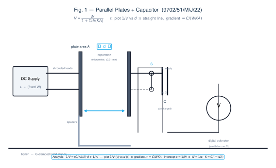
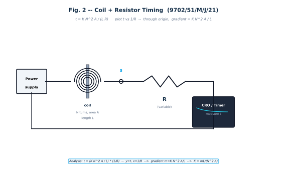
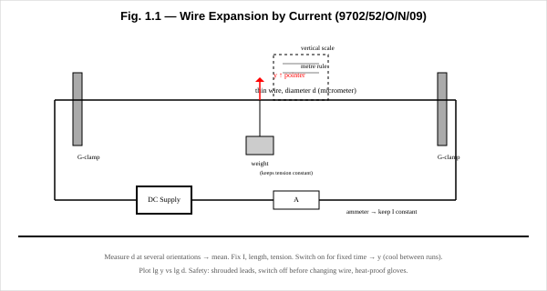
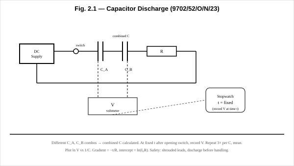
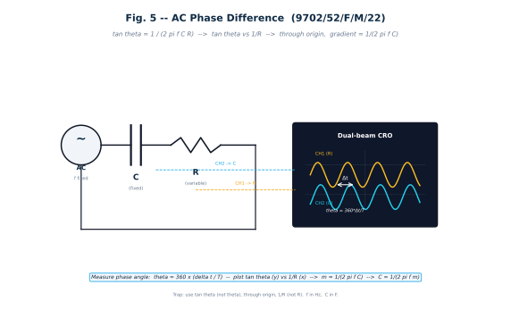

# CAIE Physics 9702 — Paper 5 ELECTRICITY FOCUS

> **Full 15/15 model answers — electricity only.** Written exactly as the mark scheme awards marks.
> Source: `paper 5 question 1 physics.md` (Q1) + `paper 5 question 2 physics.md` (Q2) + `Paper-5-WS_26x27.pdf`
> **Sir said: "both Q1 and Q2 are from electricity — anything electricity related" — these 5 are the ones to revise.**

| # | Paper | Page | Code | Question | Equation | Graph |
|---|-------|------|------|----------|----------|-------|
| 1 | **Q1** | 31 | 9702/51/M/J/22 | **Parallel plates + capacitor** | $V = \frac{W}{1+Cd/(KA)}$ | $1/V$ vs $d$ |
| 2 | **Q1** | 34 | 9702/51/M/J/21 | **Coil + resistor timing** | $t = \frac{KN^{2}A}{LR}$ | $t$ vs $1/R$ |
| 3 | **Q1** | 37 | 9702/52/O/N/09 | **Wire heated by current** | $y = p d^{\,q}$ | $\lg y$ vs $\lg d$ |
| 4 | **Q2** | 73 | 9702/52/O/N/23 | **Capacitor discharge** | $V = I_{0}R\,e^{-t/CR}$ | $\ln V$ vs $1/C$ |
| 5 | **Q2** | 77 | 9702/52/F/M/22 | **AC phase (capacitor + resistor)** | $\tan\theta = \frac{1}{2\pi fCR}$ | $\tan\theta$ vs $1/R$ |

> **Do 1, 4, 5 first if short on time** — $C,R,V,I,f$ appear every year.

---

# PART A — Q1 PLANNING — Full 15/15 Model Answers

---

## Q1-1 — Parallel Plates + Capacitor (9702/51/M/J/22) — $V = \frac{W}{1+Cd/(KA)}$

### Model Answer (copy this structure in exam — 15 marks)

**Variables:**
- Independent variable: separation $d$ of the parallel plates (varied using spacers/micrometer screw).
- Dependent variable: potential difference $V$ across the uncharged capacitor after connection.
- Quantities to be kept constant: capacitance $C$ of the uncharged capacitor, plate area $A$, constant $W$ (supply/charge conditions), and $K$. Also keep temperature constant.

**Apparatus (list):** Two parallel metal plates (area $A$, separation $d$ variable), d.c. power supply, uncharged capacitor $C$, digital voltmeter, micrometer screw gauge (0.01 mm) and vernier calipers for $A$, spacers, shrouded leads, G-clamp, bench.

**Diagram:** As shown above — plates connected to supply for charging, then switched to capacitor $C$ with voltmeter in parallel across $C$. Plates mounted vertically on G-clamped retort stand. Label $d$ between plates, area $A$, capacitor $C$, voltmeter $V$, supply. Use correct circuit symbols.

**Procedure (step-by-step):**
1. Measure plate dimensions (length and width) with vernier calipers at several positions and orientations, calculate mean and hence area $A = l \times w$. Record.
2. Set initial small separation $d$ using spacers. Measure $d$ with micrometer screw gauge at at least 3 different positions between plates, calculate mean $d$ and half-range as uncertainty.
3. Connect plates to d.c. supply and charge for a fixed time (e.g. 30 s) at a fixed supply voltage (record with voltmeter — keep constant for all runs).
4. Quickly switch plates to uncharged capacitor $C$ (ensure capacitor is fully discharged before each run by shorting through a resistor). Measure p.d. $V$ across $C$ with digital voltmeter. Repeat the $V$ reading 3 times for this $d$ (recharging each time) and calculate mean $V$.
5. Increase $d$ (remove/add spacers or adjust micrometer screw) and repeat steps 2–4. Obtain at least 6 values of $d$ spanning the widest available range while keeping $d \ll \sqrt{A}$ (small-distance condition stated in question).
6. For each $d$, calculate $1/V$ and tabulate $d$, $V$, $1/V$ with uncertainties. Show one sample calculation.

**Control of variables:**
- $C$: use the same uncharged capacitor for every reading — do not change capacitor.
- $A$: use the same plates throughout — do not change plates; check $A$ is unchanged.
- Initial charge $W$: keep charging voltage and charging time identical for every run (monitor supply with voltmeter before each charge).
- Temperature and humidity kept constant by conducting in same room.

**Analysis:**
Rearrange: $V = \frac{W}{1+Cd/(KA)} \Rightarrow \frac{1}{V} = \frac{C}{WKA}\,d + \frac{1}{W}$
So plot $y = 1/V$ on y-axis against $x = d$ on x-axis.
$$ \frac{1}{V} = \left(\frac{C}{WKA}\right) d + \frac{1}{W} $$
- Gradient $m = \frac{C}{WKA}$
- y-intercept $c = \frac{1}{W}$
If the relationship is valid the graph will be a straight line. Gradient and intercept are found from the best-fit line (with worst acceptable line for uncertainties).
Then: $W = \frac{1}{c}$ and $K = \frac{C}{mWA}$ (rearrange gradient expression). $C$ and $A$ are known from measurements.

**Additional detail (D-mark):** Measure $d$ at several points between plates and average to account for non-parallelism / non-uniformity. Use large range of $d$ to reduce percentage uncertainty and improve gradient accuracy.

**Safety:**
- Electric shock: switch off supply before changing $d$ or touching plates; use shrouded leads; discharge capacitor through a resistor before handling — because plates are charged to high voltage and capacitor stores charge.
- Falling plates: G-clamp the plate stands to the bench and use a sand tray below — because plates are heavy and may topple.
- (Link hazard → precaution explicitly — generic "wear goggles" alone scores 0.)

**How to find $K,W$:** From graph, $W = 1/(\text{intercept})$, $K = C/( \text{gradient} \times W \times A)$. State both with units.

---

## Q1-2 — Coil + Resistor Timing (9702/51/M/J/21) — $t = \frac{KN^{2}A}{LR}$

### Model Answer (15 marks)

**Variables:**
- Independent: resistance $R$ of the variable resistor (different unmarked resistors).
- Dependent: time $t$ for current to reach maximum value after switch closed (few ms).
- Kept constant: number of turns $N$, cross-sectional area $A$, length $L$ of the coil, constant $K$, supply voltage.

**Apparatus:** Coil (with known $N$, $L$, $A$), set of unmarked resistors (different $R$), high-voltage d.c. power supply, switch, digital ohmmeter / multimeter, oscilloscope or data logger with timer (to measure $t$ in ms), micrometer screw gauge and metre rule, shrouded leads, G-clamp.

**Diagram:** Series circuit: supply → switch → coil → resistor $R$ → back to supply. Oscilloscope/data logger connected across resistor to detect current reaching max. Label coil with $N,L,A$, resistor $R$, switch, supply, oscilloscope. Coil clamped, resistor mounted on bench.

**Procedure:**
1. Measure coil parameters: count $N$ (given or count), measure length $L$ with metre rule (mean of several positions), measure diameter $d$ of coil with micrometer at several orientations → $A = \pi d^{2}/4$ (mean).
2. Select a resistor, measure its resistance $R$ with digital ohmmeter (mean of 2 readings), calculate $1/R$.
3. Set up series circuit with that $R$ and the coil. Ensure supply voltage is fixed (record with voltmeter — keep constant).
4. Close switch and measure time $t$ for current to reach maximum — use oscilloscope trace (time-base) or data logger; repeat the timing 3 times for this $R$ and calculate mean $t$ (video with timer in view if $t$ is very short).
5. Repeat steps 2–4 for at least 6 different resistors covering the widest available $R$ range (factor 3–5).
6. Tabulate $R$, $1/R$, $t$ (with uncertainties as half-range). Calculate $1/R$ for each.

**Control of variables:**
- $N,A,L$: use the same coil throughout — do not change coil.
- Supply voltage: keep same d.c. supply setting, check with voltmeter before each run.
- Temperature: conduct in same room; allow coil to cool between runs (coil heats and resistance changes).
- Same threshold for "maximum" defined consistently (e.g. 95% of peak on oscilloscope).

**Analysis:**
$$ t = \left(\frac{KN^{2}A}{L}\right)\frac{1}{R} $$
Plot $y = t$ on y-axis against $x = 1/R$ on x-axis.
- Gradient $m = \frac{KN^{2}A}{L}$
- Intercept $c = 0$ (through origin)
If valid, the graph is a straight line through the origin. Find gradient from best-fit line (WAL for uncertainty).
Then: $K = \frac{mL}{N^{2}A}$.

**Additional detail:** Measure coil diameter at several positions/orientations and average to reduce random error due to non-uniform winding. Use large $1/R$ range (small and large $R$) to reduce percentage uncertainty in gradient.

**Safety:**
- Electric shock: high-voltage supply — switch off before changing resistor $R$; use shrouded leads and insulating gloves.
- Burns/heat: coil becomes hot — allow to cool between readings; use heat-proof gloves; switch off supply between runs.
- Toppling: G-clamp coil and resistor stands to bench.

**How to find $K$:** $K = (\text{gradient})\times L / (N^{2}A)$ — show substitution of measured $N,A,L$.

---

## Q1-3 — Wire Heated by Current (9702/52/O/N/09) — $y = p d^{\,q}$

### Model Answer (15 marks)

**Given:** Wire of diameter $d$ carries current, becomes hot and expands, displacement $y$ of pointer measured.

**Variables:**
- Independent: diameter $d$ of wire (different wires).
- Dependent: displacement $y$ (expansion).
- Kept constant: current $I$, wire length, tension (hanging weight), wire material, heating time, ambient temperature.

**Apparatus:** Set of wires of different $d$ (same material e.g. copper, same length), micrometer screw gauge (0.01 mm), d.c. power supply + ammeter, metre rule / scale with pointer, G-clamps, weights to maintain tension, stopwatch, heat-proof mat.

**Diagram:** Horizontal wire clamped at both ends on G-clamped supports, pointer attached at centre over vertical scale/metre rule, small weight hanging at centre to keep tension, circuit: supply → ammeter → wire → back to supply. Label $d$, length, $y$ (vertical displacement of pointer), ammeter $I$, scale.

**Procedure:**
1. Measure diameter $d$ of each wire with micrometer screw gauge at several positions along the wire and in two perpendicular orientations, calculate mean $d$ and half-range uncertainty. Calculate $\lg d$.
2. Mount wire with fixed length between clamps, attach small weight at centre to keep tension constant, attach pointer at centre opposite a vertical scale.
3. Set current $I$ to a fixed value (e.g. 2.0 A), record with ammeter, keep this $I$ constant for all wires (check before each run).
4. For each wire: switch on current for a fixed heating time (e.g. 60 s, timed with stopwatch), measure displacement $y$ of pointer on the scale (3 repeats per wire, allowing wire to cool completely between repeats, mean $y$), calculate $\lg y$.
5. Repeat for at least 6 wires spanning the widest available $d$ range (thin to thick).
6. Tabulate $d$, $y$, $\lg d$, $\lg y$.

**Control of variables:**
- $I$: same supply setting, monitor with ammeter before each run — do not adjust.
- Length and tension: same wire length (measure and fix), same hanging weight for every wire.
- Material: same wire material (same batch) — so resistivity and expansion coefficient constant.
- Heating time: same duration of current flow for each wire (stopwatch).
- Ambient: same room temperature.

**Analysis:**
$$ y = p d^{q} \Rightarrow \lg y = q\,\lg d + \lg p $$
Plot $y' = \lg y$ on y-axis against $x' = \lg d$ on x-axis.
- Gradient $m = q$
- Intercept $c = \lg p$
If valid, the $\lg$-$\lg$ graph is a straight line (linear $y$ vs $d$ would be a curve and is wrong). Find gradient and intercept from best-fit line.
Then: $q = m$ (directly, no calculation), $p = 10^{c}$.

**Additional detail:** Measure $d$ at multiple orientations to account for non-circular cross-section; use large range of $d$ and plot $\lg$-$\lg$ to linearise power law — this is the D-mark for "how data is analysed".

**Safety:**
- Electric shock: switch off supply before changing wire; use shrouded leads — because current heats wire and supply is live.
- Burns: wire becomes very hot — wear heat-proof gloves, allow to cool before handling, use tongs; place heat-proof mat below.
- Falling weights: place sand tray / cushion below hanging weight — weight may fall if wire snaps.
- Eye injury: wear goggles — wire under tension may snap and recoil.

**How to find $q$:** Gradient of $\lg y$ vs $\lg d$ graph is $q$ directly. Often $q$ is negative (thinner wire → larger $y$).

---

# PART B — Q2 ANALYSIS — Full 15/15 Model Answers

---

## Q2-1 — Capacitor Discharge (9702/52/O/N/23) — $V = I_{0}R\,e^{-t/CR}$

### What the question gives you
- Capacitors $C_{A}, C_{B}$ (you calculate combined $C$ — question states how, e.g. parallel $C=C_{A}+C_{B}$ or series $1/C=1/C_{A}+1/C_{B}$).
- Fixed time $t$ (e.g. 10 s) after opening the switch — you record voltmeter reading $V$.
- Different $C_{A},C_{B}$ combos → different $C$ → different $V$.
- Equation: $V = I_{0}R e^{-t/(CR)}$ where $I_{0},R$ are constants to find.

### Part (a) — Gradient & intercept [1 mark] — MUST get this before the table
Graph is $\ln V$ on y-axis against $1/C$ on x-axis. Take natural log:

$$ \ln V = \ln(I_{0}R) - \frac{t}{R}\cdot\frac{1}{C} $$

So in $y = mx + c$:

$$ \ln V = \left(-\frac{t}{R}\right)\frac{1}{C} + \ln(I_{0}R) $$

- **Gradient** $m = -\frac{t}{R}$ (negative — $V$ falls as $C$ gets smaller → $1/C$ larger)
- **y-intercept** $c = \ln(I_{0}R)$

> Mark scheme: gradient must include minus sign and $t/R$; intercept must be $\ln(I_{0}R)$ not $I_{0}R$ or $\ln I_{0}$.

### Part (b) — Table [2 marks] — calculations + uncertainties

| $C_{A}/10^{-4}$ F | $C_{B}/10^{-4}$ F | $C/10^{-4}$ F | $1/C /10^{4}$ F$^{-1}$ | $V \pm 0.05$ V | $\ln(V/\text{V})$ | $\Delta(\ln V)$ |
|---|---|---|---|---|---|---|
| 2.2 | 2.2 | 1.10 (series) | 0.909 | 2.45 | 0.896 | 0.020 |
| 2.2 | 4.7 | 1.50 | 0.667 | 3.10 | 1.131 | 0.016 |
| 4.7 | 4.7 | 2.35 | 0.426 | 4.02 | 1.391 | 0.012 |

*How to calculate (show one row fully for the mark):*
- Combined $C$: if series, $\frac{1}{C}=\frac{1}{C_{A}}+\frac{1}{C_{B}} \Rightarrow C = \frac{C_{A}C_{B}}{C_{A}+C_{B}}$. Then $1/C = 0.909\times10^{4}$ F$^{-1}$.
- $\ln V$: $\ln(2.45)=0.896$ — give to **3 d.p.** because $V$ is 3 s.f. (WS p.7: ln → 3 d.p. when data is 3 s.f.).
- **Uncertainty in $\ln V$:** $\Delta(\ln V) = \frac{\Delta V}{V} = \frac{0.05}{2.45}=0.020$ (use $\Delta V$ = half-range or instrument resolution — WS says $(\text{max}-\text{min})/2$ or $\Delta V$ given). **Not** $0.05/(V\times2.303)$ — that's for $\lg$.
- Include units in header with solidus: $1/C /10^{4}$ F$^{-1}$, $\ln(V/\text{V})$ (dimensionless).
- Show absolute uncertainties in $\ln V$ column to 2 s.f.

> Exam tip: If axis is $1/C /10^{4}$ F$^{-1}$, your $1/C$ values are 0.909, 0.667... — keep the $10^{4}$ in the header, not in each cell.

### Part (c) — Graph [4 marks] — (i) plot + (ii) lines + (iii) gradient + (iv) intercept

**(i) Plot:** $\ln V$ (y) vs $1/C$ (x). 
- Axes: $\ln V$ (no unit) vs $1/C /10^{4}$ F$^{-1}$ (or F$^{-1}$ with $10^{4}$ noted).
- Check for **false origin** — axes need not start at 0; choose limits to use >50% of grid each direction.
- Plot points with **×** (not dots) to 0.5 small square, error bars = $\pm\Delta(\ln V)$ vertically (horizontal error in $1/C$ usually negligible — if given, include).
- Label axes with quantity and unit (solidus).

**(ii) Lines:** Draw **best-fit line** (thin, single, through points balancing above/below, not kinked) and **worst acceptable line** (WAL — steepest or shallowest that still passes through all error bars). Label both clearly "best" and "WAL".

**(iii) Gradient [2 marks]:** Draw a **large triangle** — hypotenuse at least half the length of the line. Read coordinates **from the line** (not from data points), e.g. $(x_{1},y_{1})$ and $(x_{2},y_{2})$ on the line.
$$ m = \frac{\Delta(\ln V)}{\Delta(1/C)} = \frac{y_{2}-y_{1}}{x_{2}-x_{1}} $$
- Include **power-of-10**: if x-axis is $10^{4}$ F$^{-1}$, then $m_{\text{graph}}$ is per $10^{4}$ — so $m_{\text{true}} = m_{\text{graph}}\times10^{-4}$ F.
- Show substitution: e.g. $m = (1.40-0.90)/(0.42-0.91)\times10^{-4} = -1.02\times10^{-4}$ F (sign negative).
- **Uncertainty:** $\Delta m = |m_{\text{best}}-m_{\text{WAL}}|$ or $(|m_{\text{max}}-m_{\text{min}}|)/2$.

**(iv) Intercept:** Read where line crosses $x=0$ (or calculate $c = y - mx$ using a point on the line if false origin). Give to appropriate d.p.

> Mark scheme for (c)(iv): $c = y - mx$ using a point on the best-fit line — not reading intercept directly if axes don't include 0.

### Part (d) — Constants from gradient & intercept [2 marks]

- Gradient $m = -t/R \Rightarrow R = -t/m$.
  E.g. $t=10$ s fixed, $m=-1.02\times10^{-4}$ F → $R = 10/1.02\times10^{4} = 9.8\times10^{3}$ Ω. Include unit Ω.
- Intercept $c = \ln(I_{0}R) \Rightarrow I_{0}R = e^{c} \Rightarrow I_{0} = e^{c}/R$.
  E.g. $c=1.82$ → $e^{1.82}=6.17$ → $I_{0}=6.17/R$.

Include uncertainties: $\Delta R /R = \Delta m /|m|$ (if $t$ exact), $\Delta I_{0}/I_{0} = \Delta c + \Delta R/R$ (via $e^{c}$).

### Part (e) — Use constants to find new $V$ or $C$ [1–2 marks]

E.g. "Find $V$ when $C=3.0\times10^{-4}$ F": $V = I_{0}R e^{-t/(CR)}$ with found $I_{0},R,t$.

### Common traps (lose all 4 graph marks)
- Using $\lg$ (base 10) instead of $\ln$ — intercept would be $\lg(I_{0}R)$, wrong.
- Forgetting minus sign in gradient.
- Mixing $C$ (in F) with $1/C$ — axis is $10^{4}$ F$^{-1}$, not F.
- $\Delta(\ln V)=0.05/(V\times2.303)$ — that's for $\lg$, not $\ln$.
- Reading gradient from data points not the line.
- Small triangle (< half line) — loses gradient mark.

---

## Q2-2 — AC Phase Difference (9702/52/F/M/22) — $\tan\theta = \frac{1}{2\pi fCR}$

### What the question gives you
- Series circuit: a.c. power supply (frequency $f$) → capacitor $C$ → resistor $R$ (variable) → back to supply.
- Dual-beam oscilloscope: CH1 across $C$, CH2 across $R$ — two sine traces with phase difference $\theta$ (Fig. 2.2).
- Different $R$ → different $\theta$ (measured from oscilloscope).
- Equation: $\tan\theta = \frac{1}{2\pi fCR}$.

### Part (a) — Gradient & intercept [1 mark]

Graph is $\tan\theta$ on y-axis against $1/R$ on x-axis.

$$ \tan\theta = \left(\frac{1}{2\pi fC}\right)\frac{1}{R} + 0 $$

- **Gradient** $m = \frac{1}{2\pi fC}$
- **y-intercept** $c = 0$ (through origin)

> Mark scheme: must include $2\pi fC$ in denominator; intercept = 0 (not $\ln$ or $\lg$ form).

### Part (b) — Table

For each $R$:
- Measure $\theta$ from oscilloscope: $\theta = 360° \times (\Delta t / T)$ where $\Delta t$ is time shift between traces, $T$ is period ($T=1/f$ from time-base × horizontal divisions). Or read directly if oscilloscope shows phase.
- Calculate $\tan\theta$ (calculator in **degrees** — $\theta$ is in degrees).
- Calculate $1/R$ (in Ω$^{-1}$ or $10^{-3}$ Ω$^{-1}$ if $R$ in kΩ — keep power-of-10 in header).
- If $\Delta\theta$ given, $\Delta(\tan\theta) = \sec^{2}\theta \cdot \Delta\theta_{\text{rad}}$ or approximate $(\tan(\theta+\Delta\theta)-\tan(\theta-\Delta\theta))/2$.

Example row: $R=470$ Ω → $1/R=2.13\times10^{-3}$ Ω$^{-1}$, $\theta=35°\pm2°$ → $\tan\theta=0.700\pm0.042$.

### Part (c) — Graph [4 marks]

- Axes: $\tan\theta$ (no unit) vs $1/R$ / $10^{-3}$ Ω$^{-1}$.
- False origin check — need not start at 0 if data far from 0, but **intercept test matters**: if theory says through origin, check if best-fit line passes through error bars at origin — if not, systematic error.
- Plot with ×, error bars $\pm\Delta(\tan\theta)$ vertically.
- Best-fit + WAL, both labelled. Large triangle ($\geq$ half line) for gradient.

$$ m = \frac{\Delta(\tan\theta)}{\Delta(1/R)} $$

- Include power-of-10: if x-axis is $10^{-3}$ Ω$^{-1}$, $m_{\text{true}} = m_{\text{graph}}\times10^{3}$ Ω.
- Uncertainty $\Delta m$ from WAL.

### Part (d) — Find $C$ (or $f$) from gradient [2 marks]

$$ m = \frac{1}{2\pi fC} \Rightarrow C = \frac{1}{2\pi f m} $$

- $f$ is given (a.c. supply frequency, e.g. 50 Hz or 1.0 kHz) — keep $f$ constant for all $R$ (control variable).
- Substitute $m_{\text{true}}$ with correct power-of-10: e.g. $m_{\text{graph}}=0.150$ (for $10^{-3}$ axis) → $m_{\text{true}}=150$ Ω → $C=1/(2\pi\times1000\times150)=1.06\times10^{-6}$ F = 1.06 μF.
- Units: F (or μF with $10^{-6}$).
- Uncertainty: $\Delta C /C = \Delta m /m$ (if $f$ exact) or add $\Delta f/f$.

If instead $C$ is known and $f$ to find: $f = 1/(2\pi C m)$.

**Intercept check:** Theory says 0 — if intercept from graph is $0$ within uncertainty (passes through error bars at origin), relationship valid. If intercept significantly non-zero → systematic error (e.g. oscilloscope not zeroed, or $C$ not constant).

### Part (e) — Use [1 mark]

E.g. "Find $\theta$ when $R=1.0$ kΩ": $\tan\theta = 1/(2\pi fCR)$ → $\theta = \arctan(...)$.

### Common traps
- Forgetting $2\pi$ — gradient is $1/(2\pi fC)$ not $1/(fC)$.
- Calculator in radians when $\theta$ in degrees — $\tan(35°)=0.700$ but $\tan(35\text{ rad})$ is different.
- Not converting $C$ from μF to F ($1$ μF $=10^{-6}$ F).
- Forcing line through origin when data shows intercept — lose WAL mark.
- Small triangle, reading points off data not the line.
- Power-of-10 error: $R$ in kΩ → $1/R$ in $10^{-3}$ Ω$^{-1}$ — gradient off by 1000× if ignored.

## Quick Revision Checklist — Electricity Only

**Q1 Planning (15 marks) — write for each of the 3:**
- [ ] Independent / dependent / constants identified (use "kept constant", not "control")
- [ ] Workable labelled diagram (shrouded leads, correct symbols, G-clamped) — see SVGs above
- [ ] Instrument for every measurement (micrometer for $d$, ohmmeter for $R$, oscilloscope for $t$)
- [ ] How each constant is kept constant (not just listed)
- [ ] Rearranged to $y=mx+c$ with gradient & intercept as full expressions
- [ ] D-mark: averaging at multiple positions/orientations, large range (6 values)
- [ ] Two specific safety: shock (switch off + shrouded leads) + burns/eyes (gloves/goggles) — linked to hazard

**Q2 Analysis (15 marks) — for each of the 2:**
- [ ] Part (a): Gradient & intercept as full expressions with sign
- [ ] Part (b): $\ln$ → 3 d.p. (3 s.f.), $\Delta(\ln V)=\Delta V/V$, $1/C$ correctly calculated
- [ ] Part (c): False origin checked, error bars = $\pm\Delta$, WAL labelled, large triangle ($\geq$ half line)
- [ ] Power-of-10: axis multipliers included ($/10^{-4}$, $/10^{3}$)
- [ ] Part (d): $c=\ln(I_{0}R) \to I_{0}=e^{c}/R$, $m=-t/R \to R=-t/m$ (watch sign)

> **Extracted and expanded from:** `paper 5 question 1 physics.md` Plans 7,8,9 + `paper 5 question 2 physics.md` Sections for capacitor & phase. Diagrams are original SVGs in `diagrams/` — print them with the notes. Full guides remain at those files.
