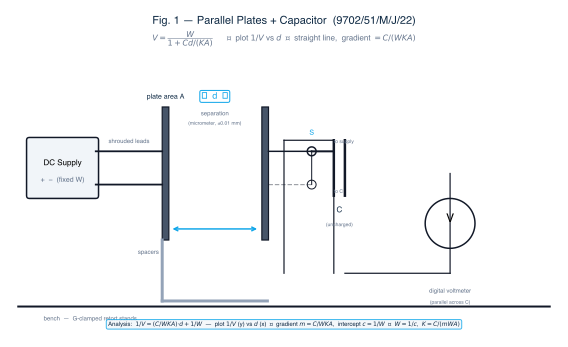
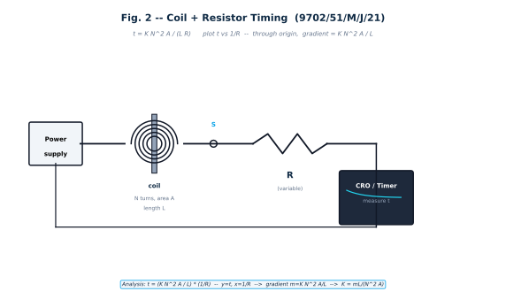
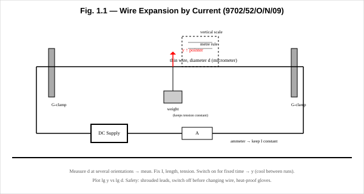

# CAIE Physics 9702 — Paper 5 Question 1 Complete Planning Guide

> **What is Question 1?** You design a laboratory experiment to test a suggested relationship. You must:
> 1. Describe the procedure to be followed
> 2. State the measurements to be taken (instruments + how)
> 3. Explain control of variables (fair test)
> 4. Explain analysis of data ($y=mx+c$, gradient & intercept → constants)
> 5. State safety precautions (specific hazard → precaution)
>
> **Always 15 marks. Always the same 5 bullets — only the equation changes.**

---

## Mark Breakdown (Exactly What Examiners Award)

| Area | What earns marks | Marks |
|------|------------------|-------|
| **Variables & constants** | Independent, dependent, quantities to keep constant identified | 1 |
| **Apparatus & diagram** | Workable labelled diagram, correct symbols, realistic setup | 2 |
| **Procedure** | Logical step-by-step method, sensible range & repeats | 3 |
| **Measurements** | Correct instruments named + how each quantity is measured | 2 |
| **Control of variables** | Each constant → how it is kept constant | 1 |
| **Analysis** | Rearrange to $y=mx+c$, state gradient & intercept, straight line test + how to find constants | 3 |
| **Additional detail (D)** | Concrete refinements (averaging, alignment, large values…) | 1 |
| **Safety** | Specific hazard → specific precaution (not generic) | 2 |
| **Total** | | **15** |

> **Key rule:** Examiners mark *what you write*, not what you meant. Use the exact phrases in the templates below.

---

## Section 1: Variables — Identify Them First

For every question, write three lines at the start:

```
Independent variable: [quantity you deliberately change]
Dependent variable:   [quantity you measure as a result]
Constants:            [everything else that must not change]
```

| # | Suggested relationship | Independent | Dependent | Keep constant |
|---|------------------------|-------------|-----------|---------------|
| 1 | $\frac{4}{3}\pi r^{3}gh = PK$ (ball in air column) | $r$ (radius of ball) | $h$ (height of stationary ball) | $P$ (motor power), air speed setting, air column diameter, room temperature |
| 2 | $I = I_{0}e^{-\alpha\rho t}$ (foam reflection) | $t$ (foam thickness) | $I$ (reflected intensity) | $\rho$ (foam density — same foam type), $I_{0}$ (incident intensity / speaker power), distance speaker–wall, frequency |
| 3 | $\frac{v}{f}=2L+kd$ (tubes, stationary waves) | $d$ (tube diameter) | $f$ (resonant frequency) | $L$ (tube length), $v$ (speed of sound — same room, same temperature), end-correction conditions |
| 4 | $\frac{2d}{t^{2}} = \frac{AHg\sin\theta}{A+B} - \frac{KA}{A+B}$ (cube + cylinder on incline) | $\theta$ (incline angle) | $t$ (fall time for distance $d$) | $d$ (fall distance), $A,B$ (masses), pulley & string, surface of plane |
| 5 | $E = am + b$ (water heater + metal blocks) | $m$ (mass of blocks) | $E$ (electrical energy for fixed $\Delta T$) | $\Delta T$ (temperature rise), mass & volume of water, initial water temperature, heater power stability |
| 6 | $\frac{Kf_{0}}{f}=\beta K+mr^{2}$ (turntable + putty) | $m$ (mass of putty) | $f$ (frequency after putty added) | $r$ (distance from centre), $f_{0}$ (initial frequency), $K$ (turntable inertia factor), turntable & motor |
| 7 | $V = \frac{W}{1+Cd/(KA)}$ (capacitor plates) | $d$ (plate separation) | $V$ (p.d. across capacitor) | $C$ (capacitor), $A$ (plate area), $W$ (supply/W — whatever constant the question defines), charge conditions |
| 8 | $t = \frac{KN^{2}A}{LR}$ (coil timing) | $R$ (resistance/circuit variable) | $t$ (time/period) | $N,A,L$ (coil geometry), supply voltage, temperature |
| 9 | $y = p d^{\,q}$ (wire expansion by current) | $d$ (wire diameter) | $y$ (displacement) | Current $I$, wire length/tension, material, heating time |
| 10 | $t = \frac{Kz^{q}}{AB\rho}$ (copper sheet damping) | $z$ (sheet thickness) | $t$ (time to stationary) | $A,B,\rho$ (sheet area, field, density), initial displacement |
| 11 | $v^{2} = \frac{2KB^{2}L^{2}A^{2}}{m}\cdot\frac{1}{s^{4}} - \frac{2Q}{m}$ (magnetic trolley) | $s$ (magnet separation) | $v$ (speed at $P$) | $m,B,L,A,D$ (trolley mass, field, magnet size, fixed distance) |

> **Trap:** Do NOT write "control variable". Write "quantity to be kept constant". The word *control* loses the mark.

---

## Section 2: Diagrams — Workable, Labelled, Correct Symbols

**Checklist (every diagram must pass):**
- [ ] Real laboratory apparatus (retort stand, clamp, bench, power supply — not abstract shapes)
- [ ] Standard symbols: battery, ammeter, voltmeter, resistor, capacitor, light gate, oscilloscope, signal generator, loudspeaker, microphone
- [ ] All parts labelled (e.g. "micrometer screw gauge at wire", "light gate connected to timer")
- [ ] Distances/angles marked ($d$, $r$, $\theta$, $h$, $L$)
- [ ] Workable: clamped, stable, measurable (no floating components, no impossible geometry)

**4 exemplar sketches (describe in words — draw them in exam):**

1. **Ball in air column:** Vertical transparent tube/column on retort stand, air blower at bottom connected to d.c. supply + ammeter/voltmeter, ball inside column, metre rule vertically alongside to measure $h$, set of balls of different $r$ (measured with micrometer).
2. **Foam reflection:** Wall, foam sheet of thickness $t$ attached to wall, loudspeaker on stand facing wall at fixed distance, sound-level meter/microphone at fixed position, signal generator + oscilloscope, metre rule for $t$ (or micrometer for thin foam).
3. **Tube stationary waves:** Set of cylindrical tubes (different $d$, same $L$) on bench, loudspeaker at one end driven by signal generator, microphone + oscilloscope at other end to detect resonance, frequency read from generator/oscilloscope.
4. **Cube on incline:** Incline plane on bench with protractor/angle scale, wooden cube (mass $A$) on plane, string over pulley at top of plane, cylinder (mass $B$) hanging, metre rule for $d$, stopwatch / light gate + timer for $t$, G-clamp securing plane.

> **Exam tip:** Use pencil + ruler. No artistic shading. Label every wire as "shrouded lead".

---

## Section 3: Measurements — Instruments & How You Use Them

| Quantity | Instrument | How you measure (exact phrase to write) |
|----------|------------|------------------------------------------|
| $r$, $d$ (small lengths, diameters, thickness) | **Micrometer screw gauge** (0.01 mm) or **vernier calipers** (0.1 mm/0.02 mm) | "Measure diameter at several positions and orientations along the wire/rod/ball, calculate mean; $r = d/2$" |
| $h$, $L$, $d$ (larger lengths) | **Metre rule** (1 mm) or **tape measure** | "Measure with metre rule to nearest 1 mm, with set square to ensure vertical/horizontal alignment" |
| $m$ (mass) | **Top-pan / electronic balance** (0.1 g or 0.01 g) | "Measure mass on calibrated electronic balance, tare before each reading" |
| $t$ (time, fall time, period) | **Stopwatch** (0.01 s) or **light gate + timer/data logger** | "Time for 10 oscillations, divide by 10; or light gate measures time for card of known length: $v=$ length/time" |
| $f$ (frequency) | **Oscilloscope** or **signal generator display** | "Display one cycle on oscilloscope, measure period $T$ from time-base × horizontal span, then $f=1/T$" |
| $V$, $I$ | **Digital voltmeter/ammeter** | "Measure p.d. with voltmeter in parallel, current with ammeter in series, using correct ranges" |
| $\theta$ (angle) | **Protractor** or **digital angle gauge** | "Measure angle between plane and horizontal with protractor, ensure plane is straight" |
| $I$ (sound intensity) | **Sound-level meter** or **microphone + oscilloscope** (amplitude ∝ intensity) | "Record amplitude on oscilloscope, convert via calibration; keep microphone distance fixed" |
| Temperature | **Thermometer** (0.1 °C) | "Record initial and final temperatures, ensure same volume of water" |

**Additional phrases that earn D-marks:**
- "Repeat each measurement at least 3 times and calculate mean"
- "Measure at multiple positions/orientations and average to reduce random error"
- "Use large values of $d/L/t$ to reduce percentage uncertainty"

---

## Section 4: Control of Variables — Fair Test

For each constant, say **how** you keep it constant — not just that you will.

| Constant | How to keep it constant (write this) |
|----------|---------------------------------------|
| $P$ (motor power) | "Use same d.c. supply, fixed voltage; monitor with voltmeter/ammeter; do not adjust during experiment" |
| $L$ (tube length) | "Use tubes of same length $L$ (measure and select); or fix one tube length in clamp" |
| $A,B$ (masses) | "Use same cube and cylinder for all readings — do not change masses" |
| Water volume/mass | "Use same beaker and same volume of water measured with measuring cylinder before each run" |
| $\rho$ (foam density) | "Use foam from same sheet/batch; same material" |
| $r$ (putty distance) | "Place putty at same distance $r$ from centre each time (mark position on turntable)" |
| Supply voltage | "Use same power supply setting, check with voltmeter before each reading" |

> **Template sentence:** "To ensure a fair test, [quantity] will be kept constant by [specific method]. This will be checked by [instrument] before each reading."

---

## Section 5: Analysis — Rearrange to $y = mx + c$

Write the rearranged equation, identify gradient & intercept, state the straight-line test, and how to find constants.

| # | Original | Choose $y$ | Choose $x$ | Rearranged $y = mx + c$ | Gradient $m$ | Intercept $c$ | How to find constants |
|---|----------|-----------|------------|--------------------------|--------------|----------------|------------------------|
| 1 | $\frac{4}{3}\pi r^{3}gh = PK$ | $h$ or $r^{3}$ — plot $h$ vs $1/r^{3}$ | $1/r^{3}$ | $h = \frac{3PK}{4\pi g}\cdot\frac{1}{r^{3}}$ | $\frac{3PK}{4\pi g}$ | $0$ (through origin) | $K = \frac{4\pi g}{3P}\times m$ |
| 2 | $I=I_{0}e^{-\alpha\rho t}$ | $\ln I$ | $t$ | $\ln I = -\alpha\rho\,t + \ln I_{0}$ | $-\alpha\rho$ | $\ln I_{0}$ | $\alpha = -m/\rho$, $I_{0}=e^{c}$ |
| 3 | $v/f = 2L+kd$ | $1/f$ | $d$ | $\frac{1}{f}= \frac{k}{v}d + \frac{2L}{v}$ | $k/v$ | $2L/v$ | $v = 2L/c$, $k = m\cdot v$ |
| 4 | $2d/t^{2}=AHg\sin\theta/(A+B)-KA/(A+B)$ | $2d/t^{2}$ | $\sin\theta$ | $\frac{2d}{t^{2}} = \frac{AHg}{A+B}\sin\theta - \frac{KA}{A+B}$ | $\frac{AHg}{A+B}$ | $-\frac{KA}{A+B}$ | $H = m(A+B)/(Ag)$, $K = -c(A+B)/A$ |
| 5 | $E=am+b$ | $E$ | $m$ | $E = a m + b$ | $a$ | $b$ | $a=m$, $b=c$ directly |
| 6 | $Kf_{0}/f = \beta K + mr^{2}$ | $Kf_{0}/f$ | $m$ | $\frac{Kf_{0}}{f}= r^{2}m + \beta K$ | $r^{2}$ | $\beta K$ | Check: if $r$ known, $m$ checks $r^{2}$; $\beta = c/K$ |
| 7 | $V=W/(1+Cd/KA)$ | $1/V$ | $d$ | $\frac{1}{V}= \frac{C}{WKA}d + \frac{1}{W}$ | $\frac{C}{WKA}$ | $1/W$ | $W=1/c$, $K = C/(mWA)$ |
| 8 | $t = KN^{2}A/(LR)$ | $t$ | $1/R$ | $t = \frac{KN^{2}A}{L}\cdot\frac{1}{R}$ | $\frac{KN^{2}A}{L}$ | $0$ | $K = mL/(N^{2}A)$ |
| 9 | $y=pd^{q}$ | $\lg y$ | $\lg d$ | $\lg y = q\lg d + \lg p$ | $q$ | $\lg p$ | $q=m$, $p=10^{c}$ |
| 10 | $t=Kz^{q}/(AB\rho)$ | $\lg t$ | $\lg z$ | $\lg t = q\lg z + \lg(K/AB\rho)$ | $q$ | $\lg(K/AB\rho)$ | $q=m$, $K=10^{c}AB\rho$ |
| 11 | $v^{2}\propto 1/s^{4}$ | $v^{2}$ | $1/s^{4}$ | $v^{2} = \frac{2KB^{2}L^{2}A^{2}}{m}\cdot\frac{1}{s^{4}} - \frac{2Q}{m}$ | $2KB^{2}L^{2}A^{2}/m$ | $-2Q/m$ | $K=m\cdot gradient/(2B^{2}L^{2}A^{2})$, $Q=-cm/2$ |

> **Validity statement to write:** "If the suggested relationship is valid, the graph of $y$ against $x$ will be a straight line [through the origin if intercept = 0]. If the relationship is not valid, the points will be scattered/curved and not lie on a straight line."

**Steps after plotting (link to Q2 skills):**
1. Plot $y$ vs $x$ with error bars
2. Draw best-fit + worst acceptable line, find $m\pm\Delta m$ and $c\pm\Delta c$
3. Equate $m$ to expression, solve for unknown constant
4. For $ \ln$ intercept: $X = e^{c}$

---

## Section 6: Safety — Specific Hazard → Specific Precaution

| Hazard | Specific precaution (write hazard + precaution linked) |
|--------|--------------------------------------------------------|
| Falling masses / balls / blocks / cylinder | "Place sand box / cushion / foam tray beneath to catch falling masses and prevent injury or damage" |
| Snapping elastic / springs / string under tension | "Wear safety goggles / use safety screen to protect eyes from snapping string or recoiling masses" |
| Toppling retort stand / plane / column | "Secure stand/plane to bench with G-clamp or heavy weights to prevent toppling" |
| Electric shock (high voltage, heater, capacitor) | "Switch off supply before changing circuit; use shrouded leads and insulating gloves" |
| Burns (hot water, heater, metal blocks) | "Wear heat-proof gloves / use tongs; switch off heater between readings to allow cooling; handle beakers with care" |
| Spillage (water, oil) | "Carry out over large tray/bowl to contain spills; mop up immediately" |
| Loud sound (speaker, signal generator) | "Wear ear defenders / ear muffs when using loud speaker near wall" |
| Intense light (laser if used) | "Do not look directly into beam; wear dark glasses; conduct in dim room if needed" |
| Sharp edges (metal plates, cut foam) | "Wear gloves when handling plates with sharp edges" |

> **Trap:** Generic "wear goggles" without saying *why* loses the mark. Always link: "Wear goggles **because** masses may fall / string may snap and cause eye injury."

---

## Section 7: Additional Detail (D-Marks) — Concrete Refinements

| Refinement | Exact sentence to write |
|------------|--------------------------|
| Averaging dimensions | "Measure diameter at several positions and in two perpendicular orientations with micrometer, then calculate mean to reduce random error and account for non-uniformity" |
| Vertical/horizontal alignment | "Use set square against bench / plumb line to ensure column/ruler/plane is perfectly vertical/horizontal" |
| Maximise signal | "Rotate microphone/Hall probe to obtain maximum reading; use cone to focus sound if needed" |
| Background control | "Stir water to ensure uniform temperature; wait for oscillations to become steady before timing; switch off fans/draughts; conduct in dark/quiet room" |
| Large values | "Use large values of $d/L/t$ to reduce percentage uncertainty; choose range that gives measurable variation in dependent variable" |
| Fiducial marker | "Place marker at equilibrium position / on rule to judge start and end of motion accurately" |
| Video timing | "Record motion with video camera with timer in view, replay frame-by-frame to determine short intervals accurately" |
| Repeats | "Repeat each measurement at least 3 times and calculate mean; calculate half-range as uncertainty" |

---

## Section 8: 11 Full Worked Q1 Plans

### Plan 1 — Ball in Air Column (9702/51/O/N/19) — $\frac{4}{3}\pi r^{3}gh = PK$

**Given:** Vertical column, ball radius $r$, stationary height $h$, motor power $P$, constants $g,K$.

**y=mx+c:** Plot $h$ vs $1/r^{3}$:
$$h = \frac{3PK}{4\pi g}\cdot\frac{1}{r^{3}}$$
So $y=h$, $x=1/r^{3}$, $m=3PK/(4\pi g)$, $c=0$ (through origin).

**Variables:** Independent $r$, dependent $h$, constants $P,g$.

**Apparatus:** Air blower + d.c. supply + voltmeter/ammeter, vertical transparent tube on retort stand, set of polystyrene balls of different $r$, micrometer screw gauge, metre rule, balance (if needed for density check).

**Method:**
1. Measure diameter of each ball with micrometer at several orientations, mean → $r=d/2$, calculate $1/r^{3}$.
2. Set up vertical column, clamp securely with G-clamp, metre rule alongside.
3. Fix power $P$ (record $V$ and $I$, calculate $P=VI$), do not change.
4. Place smallest ball in column, adjust air flow until stationary, measure $h$ from base/blower to centre of ball with metre rule + set square (3 repeats, mean).
5. Repeat for at least 6 different $r$ values spanning widest range available.
6. Tabulate $r$, $1/r^{3}$, $h$ (with uncertainties).
7. Plot $h$ (y) vs $1/r^{3}$ (x).
8. Draw best-fit line through origin if valid; find gradient $m$.

**Controls:** Same blower power $P$ (check $V,I$ before each reading), same column, same ambient temperature, same air supply setting.

**Analysis:** $K = 4\pi g m/(3P)$. Calculate with $g=9.81\,\text{m s}^{-2}$. Straight line through origin validates relationship; scatter/curve disproves.

**Safety:** Goggles (ball may be ejected), sand tray below column (falling ball), G-clamp (toppling), shrouded leads (electric shock).

---

### Plan 2 — Foam Reflection (9702/52/M/J/15) — $I = I_{0}e^{-\alpha\rho t}$

**y=mx+c:** $\ln I = -\alpha\rho\,t + \ln I_{0}$ → $y=\ln I$, $x=t$, $m=-\alpha\rho$, $c=\ln I_{0}$.

**Variables:** Independent $t$, dependent $I$, constants $\rho, I_{0}$, frequency, geometry.

**Apparatus:** Loudspeaker + signal generator (fixed frequency/amplitude), foam sheets of different $t$ (same $\rho$), wall, sound-level meter or microphone + oscilloscope, micrometer for $t$, metre rules for distances, tape to fix foam.

**Method:**
1. Measure thickness $t$ of each foam sheet with micrometer/vernier at several points, mean.
2. Fix geometry: loudspeaker at fixed distance from wall (mark position), microphone/sound meter at fixed position and orientation.
3. Without foam, record $I_{0}$ or keep as intercept; with each foam thickness, emit sound pulse, measure reflected intensity $I$ (amplitude on oscilloscope or dB converted to intensity — 3 repeats, mean).
4. Vary $t$ over at least 6 values (0 to max available, using stacked sheets if needed — ensure same $\rho$).
5. Calculate $\ln I$ for each, tabulate $t$, $I$, $\ln I$.
6. Plot $\ln I$ vs $t$, best-fit line, gradient $m$.

**Controls:** Same foam type ($\rho$ constant — same batch), same incident intensity $I_{0}$ (same generator setting, check before each reading), same distances, same frequency, same room (quiet, no draughts).

**Analysis:** $\alpha = -m/\rho$. $I_{0}=e^{c}$. Straight line validates exponential attenuation; curve would indicate non-exponential or varying $\rho$.

**Safety:** Ear defenders (loud sound), goggles if cutting foam, secure speaker stand with G-clamp.

---

### Plan 3 — Stationary Waves in Tubes (9702/51/O/N/21) — $v/f = 2L+kd$

**y=mx+c:** $1/f = (k/v)d + 2L/v$ → $y=1/f$, $x=d$, $m=k/v$, $c=2L/v$.

**Variables:** Independent $d$, dependent $f$, constants $L,v$.

**Apparatus:** Set of cylindrical tubes (same length $L$, different diameters $d$), loudspeaker + signal generator (variable frequency), microphone + oscilloscope, vernier calipers for $d$, metre rule for $L$.

**Method:**
1. Measure $L$ of tubes with metre rule, select set with same $L$ (or measure each and confirm).
2. Measure diameter $d$ of each tube with vernier calipers at several orientations, mean.
3. For each tube, place loudspeaker at one end, microphone at other, vary frequency slowly until stationary wave pattern (maximum amplitude on oscilloscope) is observed — record resonant $f$ (read from generator/oscilloscope, $f=1/T$).
4. Repeat tuning 3 times per tube, mean $f$, calculate $1/f$.
5. At least 6 tubes covering widest $d$ range.
6. Plot $1/f$ vs $d$, best-fit line.

**Controls:** Same $L$ (critical — measure and select), same temperature (so $v$ constant — record room temp, avoid draughts), same tube material/end conditions, same loudspeaker power.

**Analysis:** $v = 2L/c$, then $k = m\cdot v$. Check straight line — intercept should be $2L/v$ (non-zero). $k$ is end-correction factor.

**Safety:** Ear defenders (loud resonance), G-clamp tubes, shrouded leads.

---

### Plan 4 — Cube on Incline (9702/51/M/J/23) — $\frac{2d}{t^{2}} = \frac{AHg\sin\theta}{A+B} - \frac{KA}{A+B}$

**y=mx+c:** $y=2d/t^{2}$, $x=\sin\theta$, $m=AHg/(A+B)$, $c=-KA/(A+B)$.

**Variables:** Independent $\theta$, dependent $t$ (for fixed $d$), constants $d,A,B,H,K,g$.

**Apparatus:** Inclined plane with angle scale/protractor, wooden cube mass $A$, cylinder mass $B$, string + pulley at top of plane, metre rule for $d$, stopwatch or light gate + timer, balance for $A,B$, G-clamp.

**Method:**
1. Measure masses $A,B$ on electronic balance.
2. Set up plane at angle $\theta$ (measure with protractor/digital gauge), clamp plane securely.
3. Fix distance $d$ (mark start and end positions for cylinder fall — use fiducial markers).
4. Place cube on plane, string over pulley, cylinder hanging, hold at rest.
5. Release and time fall through $d$ — use light gate at bottom or stopwatch (3 repeats per $\theta$, mean $t$), calculate $2d/t^{2}$.
6. Vary $\theta$ over at least 6 values (e.g. 20° to 60°), keeping $d$ same.
7. Calculate $\sin\theta$, tabulate, plot $2d/t^{2}$ vs $\sin\theta$.

**Controls:** Same $d$ (same marks), same masses $A,B$, same string/pulley (friction constant — lightly oil pulley if needed, but keep same), same plane surface (clean).

**Analysis:** Gradient $m = AHg/(A+B)$ → $H = m(A+B)/(Ag)$. Intercept $c = -KA/(A+B)$ → $K = -c(A+B)/A$. Note $H$ may be $g$ — check question defines $H$; if $H=g$ then gradient predicts $g$.

**Safety:** Sand box below cylinder (falling mass), goggles (string snap), G-clamp plane, gloves for heavy masses.

---

### Plan 5 — Water Heater (9702/53/O/N/15) — $E = am + b$

**y=mx+c:** $E = a m + b$ → $y=E$, $x=m$, $m=a$, $c=b$ (already linear).

**Variables:** Independent $m$ (mass of blocks), dependent $E$ (energy for fixed $\Delta T$), constants $\Delta T$, water mass, heater.

**Apparatus:** Beaker with water, electrical heater + power supply + voltmeter/ammeter + stopwatch (or joulemeter for $E$), metal blocks of known mass, electronic balance, thermometer (0.1°C), measuring cylinder for water, stirrer, insulation.

**Method:**
1. Measure mass $m$ of each combination of blocks on balance.
2. Measure fixed volume/mass of water with measuring cylinder/balance, pour into beaker, record initial temperature.
3. Place blocks in water, insert heater and thermometer, stir.
4. Switch on heater, record $V$ and $I$, start stopwatch; heat until temperature rises by fixed $\Delta T$ (e.g. 10°C), record time $t$; calculate $E = VIt$ (or read joulemeter).
5. Allow to cool, repeat with different $m$ (0 to max blocks, at least 6 values, including $m=0$ — no blocks).
6. Keep water mass, $\Delta T$, and heater setting identical each run.
7. Plot $E$ vs $m$, best-fit line.

**Controls:** Same water mass/volume, same $\Delta T$, same beaker, same heater and supply setting, stir before each temperature reading, same starting temperature (allow cooling between runs).

**Analysis:** Gradient $=a$, intercept $=b$. $a$ relates to specific heat of metal, $b$ to heat capacity of beaker/water. Straight line validates linear heat model.

**Safety:** Heat-proof gloves/tongs (hot water/blocks), switch off heater between runs to prevent burns, tray to catch spills, shrouded leads, G-clamp beaker, goggles.

---

### Plan 6 — Turntable + Putty (9702/54/O/N/25) — $\frac{Kf_{0}}{f}=\beta K + mr^{2}$

**y=mx+c:** $y=Kf_{0}/f$, $x=m$, $m=r^{2}$, $c=\beta K$. (Plot $f_{0}/f$ vs $m$ if $K$ is constant factor.)

**Variables:** Independent $m$, dependent $f$, constants $r,f_{0},K,\beta$.

**Apparatus:** Horizontal turntable on motor + belt, d.c. supply, putty/adhesive masses, electronic balance, tachometer or light gate + timer or smartphone slow-motion video for frequency, ruler for $r$, marker pen.

**Method:**
1. Measure mass $m$ of each putty piece on balance.
2. Mark distance $r$ from centre $C$ on turntable, keep same for all runs.
3. Set turntable rotating at $f_{0}$ (measure with light gate: $f_{0}=1/T_{0}$, or count revolutions in 10 s), record.
4. With turntable still rotating (motor off — coasting), drop putty gently at point $P$ distance $r$ from centre (use tweezers, avoid impulse), measure new frequency $f$ (same method — 3 repeats, mean).
5. Calculate $Kf_{0}/f$ (if $K$ unknown, plot $f_{0}/f$ vs $m$ — gradient $=r^{2}/K$, intercept $=\beta$).
6. Repeat for at least 6 values of $m$ (including $m=0$ baseline).
7. Plot $Kf_{0}/f$ vs $m$ (or $f_{0}/f$ vs $m$), best-fit line.

**Controls:** Same $r$ (same mark), same $f_{0}$ (same initial motor setting, check before each drop), same turntable, same putty drop height/technique, same temperature.

**Analysis:** Gradient $=r^{2}$ (check against measured $r^{2}$), intercept $=\beta K$ → $\beta = c/K$. Angular momentum conservation predicts linear relation; deviation indicates friction or off-centre drop.

**Safety:** Goggles (putty may fly off if not adhered), G-clamp turntable base, keep hands clear of rotating parts, sand tray nearby, low speeds to reduce hazard.

---

### Plan 7 — Capacitor Plates (9702/51/M/J/22) — $V = \frac{W}{1+Cd/(KA)}$ ⚡ **ELECTRICITY**



**Model Answer (15/15):**

**Variables:**
- Independent: separation $d$ of the parallel plates.
- Dependent: potential difference $V$ across the uncharged capacitor after connection.
- Kept constant: capacitance $C$, plate area $A$, constant $W$ (charge conditions), $K$, temperature.

**Apparatus:** Two parallel metal plates (area $A$, separation $d$ variable), d.c. power supply, uncharged capacitor $C$, digital voltmeter, micrometer screw gauge (0.01 mm) and vernier calipers for $A$, spacers, shrouded leads, G-clamp.

**Diagram:** As in electricity focus — plates charged by supply then switched to capacitor $C$ with voltmeter in parallel across $C$. Plates on G-clamped retort stand. Label $d$, $A$, $C$, $V$, supply. Correct symbols.

**Procedure:**
1. Measure plate dimensions (length × width) with vernier calipers at several positions/orientations, mean → $A = l \times w$.
2. Set small separation $d$ with spacers. Measure $d$ with micrometer screw gauge at 3 positions between plates, mean and half-range.
3. Charge plates at fixed supply voltage for fixed time (30 s, record with voltmeter — keep constant).
4. Quickly switch plates to uncharged capacitor $C$ (discharge $C$ through resistor before each run). Measure $V$ with voltmeter. Repeat 3× per $d$ (recharging each time), mean $V$.
5. Increase $d$ and repeat for at least 6 values while $d \ll \sqrt{A}$.
6. Calculate $1/V$, tabulate $d$, $V$, $1/V$ with uncertainties.

**Controls:** Same $C$ (same capacitor), same $A$ (same plates), same initial charge (same voltage and charging time, checked with voltmeter), same temperature.

**Analysis:** $\frac{1}{V} = \frac{C}{WKA}d + \frac{1}{W}$ → plot $1/V$ vs $d$. Gradient $m = C/(WKA)$, intercept $c = 1/W$. Straight line validates. Then $W = 1/c$, $K = C/(mWA)$.

**Additional detail:** Measure $d$ at several points and average to account for non-parallelism. Use large range of $d$ to improve gradient.

**Safety:** Switch off before changing $d$; shrouded leads; discharge capacitor through resistor — charged plates/capacitor store charge (shock). G-clamp stands (toppling). Goggles.

**How to find $K,W$:** $W = 1/(\text{intercept})$, $K = C/(\text{gradient} \times W \times A)$.

---

### Plan 8 — Coil Timing (9702/51/M/J/21) — $t = \frac{KN^{2}A}{LR}$ ⚡ **ELECTRICITY**



**Model Answer (15/15):**

**Variables:**
- Independent: resistance $R$ (different unmarked resistors).
- Dependent: time $t$ for current to reach maximum after switch closed (few ms).
- Kept constant: $N$, $A$, $L$ of coil, $K$, supply voltage.

**Apparatus:** Coil (known $N,L,A$), set of unmarked resistors, high-voltage d.c. supply, switch, digital ohmmeter, oscilloscope/data logger (ms timing), micrometer and metre rule, shrouded leads, G-clamp.

**Diagram:** Series: supply → switch → coil → resistor $R$ → back to supply. Oscilloscope across $R$ to detect current reaching max. Label coil $N,L,A$, resistor $R$, switch, supply.

**Procedure:**
1. Measure coil: count $N$, length $L$ with metre rule (mean), diameter with micrometer → $A = \pi d^{2}/4$ (several orientations, mean).
2. Select resistor, measure $R$ with ohmmeter, calculate $1/R$.
3. Set up series circuit with that $R$. Fix supply voltage (check with voltmeter).
4. Close switch, measure $t$ with oscilloscope/data logger (time-base). Repeat 3× per $R$, mean $t$.
5. Repeat for at least 6 different $R$ spanning factor 3–5.
6. Tabulate $R$, $1/R$, $t$.

**Controls:** Same coil ($N,A,L$), same supply voltage, same "maximum" threshold (e.g. 95% peak on scope), same temperature (allow coil to cool).

**Analysis:** $t = (KN^{2}A/L)(1/R)$ → plot $t$ vs $1/R$. Gradient $m = KN^{2}A/L$, intercept 0 (through origin). Straight line through origin validates. Then $K = mL/(N^{2}A)$.

**Additional detail:** Measure diameter at several orientations → average for non-uniform winding. Use large $1/R$ range.

**Safety:** Switch off before changing $R$; shrouded leads + insulating gloves — high-voltage supply. Coil gets hot — allow cooling, heat-proof gloves. G-clamp stands.

**How to find $K$:** $K = (\text{gradient})\times L / (N^{2}A)$.

---

### Plan 9 — Wire Expansion due to Current (9702/52/O/N/09) — $y = p d^{\,q}$ ⚡ **ELECTRICITY**



**Model Answer (15/15):**

**Variables:**
- Independent: diameter $d$ of wire (different wires).
- Dependent: displacement $y$ of pointer (expansion).
- Kept constant: current $I$, wire length, tension (weight), wire material, heating time, ambient temperature.

**Apparatus:** Wires of different $d$ (same material + length), micrometer screw gauge, d.c. supply + ammeter, metre rule/scale + pointer, G-clamps, weights, stopwatch, heat-proof mat.

**Diagram:** Horizontal wire clamped at both ends on G-clamped supports, pointer at centre over vertical scale, weight at centre for tension, circuit: supply → ammeter → wire. Label $d$, $y$, $I$, scale.

**Procedure:**
1. Measure $d$ with micrometer at several positions along wire and in two perpendicular orientations, mean $d$ and half-range, calculate $\lg d$.
2. Mount wire with fixed length, weight at centre for constant tension, pointer at centre over scale.
3. Fix current $I$ (e.g. 2.0 A, check with ammeter, keep constant).
4. For each wire: switch on for fixed time (60 s, stopwatch), measure $y$ on scale (3 repeats per wire, cool completely between, mean), calculate $\lg y$.
5. Repeat for at least 6 wires spanning widest $d$ range.
6. Tabulate $d$, $y$, $\lg d$, $\lg y$.

**Controls:** Same $I$ (same supply, check ammeter), same length/tension/material, same heating time, same room.

**Analysis:** $\lg y = q\lg d + \lg p$ → plot $\lg y$ vs $\lg d$. Gradient $m = q$, intercept $c = \lg p$. Straight $\lg$-$\lg$ line validates power law (linear $y$ vs $d$ is a curve — wrong). Then $q = m$, $p = 10^{c}$.

**Additional detail:** Average $d$ at multiple orientations for non-circular section. $\lg$-$\lg$ linearisation is the D-mark.

**Safety:** Switch off before changing wire; shrouded leads (shock). Wire very hot — heat-proof gloves, tongs, cool before handling, heat-proof mat. Sand tray below weight (falling weight). Goggles (wire may snap under tension).

**How to find $q,p$:** $q$ is gradient directly (often negative — thinner → larger $y$), $p = 10^{\text{intercept}}$.

---

### Plan 10 — Copper Sheet Damping in Magnetic Field (9702/52/O/N/22) — $t = \frac{K z^{q}}{A B \rho}$ 🧲 **ELECTRICITY/MAGNETISM**

**Given:** Sheet thickness $z$, area $A$, field $B$, density $\rho$, time to become stationary $t$.

**y=mx+c:** $\lg t = q\lg z + \lg\!\left(\frac{K}{AB\rho}\right)$ → $y=\lg t$, $x=\lg z$, $m=q$, $c=\lg(K/AB\rho)$.

**Variables:** Independent $z$ (different sheets), dependent $t$, constants $A,B,\rho,K$.

**Apparatus:** Set of copper sheets (same $A$, different $z$ — or same sheet filed), micrometer for $z$, electronic balance + ruler for $A$ (and $\rho$ check), electromagnet + Hall probe/teslameter for $B$, stopwatch, suspension thread, set square.

**Method:**
1. Measure $z$ of each sheet with micrometer (several points, mean), $A$ with vernier/micrometer, $B$ with Hall probe (keep magnet current fixed).
2. Suspend sheet from hole, ensure it can swing perpendicular to field, set up electromagnet with uniform $B$ region.
3. Displace to same initial angle (use protractor/fiducial), release, time $t$ until stationary with stopwatch (3 repeats, mean, video for short $t$).
4. Vary $z$ (at least 6 sheets, same $A$ ideally — or correct $A$ if it varies).
5. Calculate $\lg t$, $\lg z$, plot $\lg t$ vs $\lg z$.

**Controls:** Same $A$ (same sheet area), same $B$ (same magnet current, check with Hall probe), same material ($\rho$ constant — copper), same initial displacement, same suspension length.

**Analysis:** $q = m$, $K = 10^{c}\cdot AB\rho$. Straight $\lg$-$\lg$ line validates $t\propto z^{q}$.

**Safety:** G-clamp magnet, gloves for sharp sheet edges, switch off electromagnet between runs (heat), keep hands clear of swinging sheet.

---

### Plan 11 — Magnetic Trolley Repulsion (9702/51/O/N/24) — $v^{2} \propto \frac{1}{s^{4}}$ type 🧲 **MAGNETISM**

**Given:** Two bar magnets (length $L$, area $A$), separation $s$, trolley mass $m$, field $B$, speed $v$ at point $P$ distance $D$ from fixed pole. Suggested form (from WS p.43): $\frac{mv^{2}}{2} = K\frac{B^{2}L^{2}A^{2}}{s^{4}} - Q$ type → rearranged to $v^{2} = \frac{2KB^{2}L^{2}A^{2}}{m}\cdot\frac{1}{s^{4}} - \frac{2Q}{m}$.

**y=mx+c:** $y=v^{2}$, $x=1/s^{4}$, $m=2KB^{2}L^{2}A^{2}/m$, $c=-2Q/m$.

**Variables:** Independent $s$, dependent $v$, constants $m,B,L,A,D,Q,K$.

**Apparatus:** Bench + two identical bar magnets, trolley (mass $m$ on balance), block to fix one magnet, metre rule for $s$ and $D$, light gate + card of known length at $P$ ($v=$ length/time), data logger.

**Method:**
1. Fix one magnet to block, attach other to trolley, set separation $s$ with ruler (distance between N poles), fix $D$.
2. Hold trolley at $s$, release, light gate at $P$ measures $v$ (length/time, 3 repeats, mean, same release technique).
3. Vary $s$ over at least 6 values (small $s$ → larger $v$, ensure $s$ not so small magnets touch).
4. Calculate $v^{2}$, $1/s^{4}$, tabulate, plot $v^{2}$ vs $1/s^{4}$.

**Controls:** Same magnets ($B,L,A$), same $m$, same $D$, same trolley, same release height/technique, same bench (level, G-clamped).

**Analysis:** Gradient → $K$, intercept → $Q$. The exact rearrangement depends on OCR but the linearization is $v^{2}$ vs $1/s^{4}$ (inverse fourth power — check WS). Straight line validates magnetic repulsion model.

**Safety:** Goggles (magnets may snap together), keep fingers clear between magnets, G-clamp block, sand box at end of bench to catch trolley, low speeds.

---

---

## Section 9: Mistakes Table — 15 Traps & How to Avoid

| # | Mistake | Why it loses marks | How to avoid |
|---|---------|--------------------|--------------|
| 1 | Writing "control variable" | 0 for variables | Write "quantity to be kept constant" |
| 2 | Generic safety "wear goggles" without hazard | 0 for safety | Link: "Wear goggles **because** string may snap / mass may fall and cause eye injury" |
| 3 | Not stating how to keep constant | 0 for controls | For each constant say *how*: "Keep $P$ constant by fixing supply at 6.0 V and checking with voltmeter" |
| 4 | Forgetting to rearrange to $y=mx+c$ | 0 for analysis | Always write rearranged equation and label gradient & intercept |
| 5 | Gradient = just constant name (e.g. "$P$") | 0 | Write full expression: $3PK/(4\pi g)$, not $K$ or $P$ |
| 6 | Missing diagram or unlabeled | Lose 1-2 | Draw workable diagram with every item labelled + correct symbols |
| 7 | Not mentioning repeats / mean | Lose D-mark | "Repeat each measurement at least 3 times and calculate mean" |
| 8 | No instrument named | Lose measurement marks | Name specific instrument (micrometer, vernier, balance, light gate, oscilloscope) |
| 9 | Analysis without straight-line test | Lose analysis | "If relationship valid, graph will be straight line [through origin]; if not, scattered/curved" |
| 10 | Using wrong graph (e.g. $\ln$ vs linear) | Lose all analysis | Check: exponential → $\ln y$ vs $x$; power law → $\lg y$ vs $\lg x$; already linear → $y$ vs $x$ |
| 11 | Not saying how to find constants | Lose analysis | "Gradient $=...$, so $K = ...$ (rearrange)" — show algebra |
| 12 | Range too small (2 points) | Lose procedure | Use at least 6 values spanning widest possible range |
| 13 | Forgetting to keep water mass / $L$ / $r$ constant | Lose control | List every quantity in equation that is NOT the two plotted variables |
| 14 | Confusing $\ln$ and $\lg$ | Lose analysis | $\ln \to e^{c}$, $\lg \to 10^{c}$ — label which you used |
| 15 | No validity conclusion | Lose final mark | End with: "Compare experimental gradient/intercept with theoretical; agreement within uncertainty validates relationship" |

---

## Section 10: Templates — Copy-Paste Paragraphs

### Template A — Variables paragraph
```
The independent variable is [quantity] and will be varied by [method, e.g. using different balls/masses/thicknesses].
The dependent variable is [quantity] and will be measured by [instrument + method].
The following quantities will be kept constant to ensure a fair test: [list each with how you keep it constant].
```

### Template B — Procedure paragraph
```
1. Set up apparatus as shown in the diagram, clamping the [stand/plane/column] with a G-clamp for stability.
2. Measure [independent] with [instrument] at several positions/orientations and calculate mean (and uncertainty as half-range).
3. Fix [constants] — check before each reading with [instrument].
4. For each value of [independent], measure [dependent] three times and calculate mean.
5. Repeat for at least six values of [independent] covering the widest available range.
6. Tabulate results and calculate processed quantities (e.g. $1/r^{3}$, $\ln I$, $2d/t^{2}$).
```

### Template C — Analysis paragraph
```
The equation was rearranged into $y = mx + c$ form:
$$[y] = [m]x + [c]$$
where $y=[...]$, $x=[...]$, gradient $m=[expression]$, intercept $c=[expression]$.
A graph of $y$ against $x$ was plotted.
If the suggested relationship is valid the graph will be a straight line [through the origin if $c=0$].
The gradient and intercept were found from the best-fit line (and worst acceptable line for uncertainties).
The constants were then found by equating:
$[m] = [gradient value]$ so $[constant] = ...$
$[c] = [intercept value]$ so $[constant] = e^{c}$ or $10^{c}$ as appropriate.
Agreement between experimental and theoretical values within uncertainties supports the relationship.
```

### Template D — Safety paragraph
```
Safety precautions were taken:
- Falling masses/balls: sand box/cushion beneath to prevent injury/damage.
- Eye injury from snapping string/elastic: safety goggles / screen.
- Toppling apparatus: G-clamp / weights to secure stand.
- Electric shock: switch off supply before changing circuit; shrouded leads; insulating gloves.
- Burns: heat-proof gloves/tongs; switch off heater between readings; allow cooling.
- Loud sound: ear defenders.
Each precaution was linked to its specific hazard.
```

---

## Section 11: Checklist — 15/15 Guaranteed

**Variables — [ ]**
- [ ] Independent & dependent correctly identified
- [ ] Every other quantity in equation listed as "to be kept constant"

**Diagram — [ ]**
- [ ] Workable, realistic, clamped
- [ ] Correct electrical/optical symbols
- [ ] Every component labelled, distances/angles marked

**Procedure — [ ]**
- [ ] Step-by-step, logical order
- [ ] At least 6 values, widest range
- [ ] Repeats + mean stated

**Measurements — [ ]**
- [ ] Each quantity → specific instrument named
- [ ] How each measurement is made described (e.g. $v=$ length/time)

**Controls — [ ]**
- [ ] Each constant → specific method to keep it constant

**Analysis — [ ]**
- [ ] Equation rearranged to $y=mx+c$ shown
- [ ] Gradient & intercept expressions stated (full, not just constant name)
- [ ] Straight-line test stated (through origin if $c=0$)
- [ ] How to find each constant from $m$ and $c$ shown

**Additional detail — [ ]**
- [ ] At least one D-mark refinement (averaging, alignment, large values, background control)

**Safety — [ ]**
- [ ] Two specific hazards → specific precautions, linked

---

## Section 12: Cheat Sheet — Everything in One Page

**Q1 = 15 marks, 5 bullets — only equation changes.**

| Step | Write this |
|------|------------|
| **Variables** | Independent = $x$-axis, Dependent = $y$-axis, Rest = "kept constant" (not "control") |
| **Diagram** | Pencil + ruler, labelled, correct symbols, G-clamped, workable |
| **Measurements** | Micrometer (small $d$), vernier (medium), metre rule (large $L$), balance ($m$), light gate ($v=$ length/time), oscilloscope ($f=1/T$), thermometer, sound meter |
| **Controls** | Each constant → "kept constant by [method], checked with [instrument]" |
| **Analysis** | Rearrange to $y=mx+c$; $m=$ coeff of $x$, $c=$ rest; plot $y$ vs $x$; straight line [through origin if $c=0$]; $m=$ expression → solve for constant; $c=\ln X \to X=e^{c}$ |
| **Safety** | Falling → sand box; Eyes → goggles/screen; Toppling → G-clamp; Shock → switch off + shrouded leads; Burns → gloves/tongs + cool; Sound → ear defenders |
| **D-marks** | Average at multiple positions/orientations; set square/plumb line; rotate sensor for max; stir / wait steady; large $d/L$; fiducial marker; video frame-by-frame |
| **Repeats** | At least 3 repeats per point, mean, half-range = uncertainty |
| **Range** | At least 6 values, widest available |
| **Validity** | Straight line = valid; curved/scattered = not valid |
| **Power law** | $y=pd^{q}$ or $t=Kz^{q}/AB\rho$ → plot $\lg y$ vs $\lg d$ (gradient $=q$) — curve in linear = power law |
| **Electricity focus** | Plates $1/V$ vs $d$, Coil $t$ vs $1/R$, Wire $\lg y$ vs $\lg d$, Capacitor $\ln V$ vs $1/C$, Phase $\tan\theta$ vs $1/R$ |

> **Exam mantra:** *Variables → Diagram → Measure (with instrument) → Keep constant (with how) → $y=mx+c$ → Plot → $m,c$ → Constants → Safety (hazard→precaution).*

---

---

*Sources: Cambridge International AS & A Level Physics 9702 syllabus (2020-2025); Paper-5-WS_26x27.pdf (Nitro PDF Pro, 100 pages, March 2027 series); exhaustive checklist pp.1-8 (examiner reports & marking schemes); Q1 exemplars pp.9-43 (9702/51/O/N/19 ball, 9702/52/M/J/15 foam, 9702/51/O/N/21 tubes, 9702/51/M/J/23 cube, 9702/53/O/N/15 water heater, 9702/54/O/N/25 turntable, 9702/51/M/J/22 capacitor plates p.31, 9702/51/M/J/21 coil p.34, 9702/52/O/N/09 wire p.37, 9702/52/O/N/22 copper p.40, 9702/51/O/N/24 trolley p.43); companion Paper 5 Question 2 guide for analysis/graph skills.*
